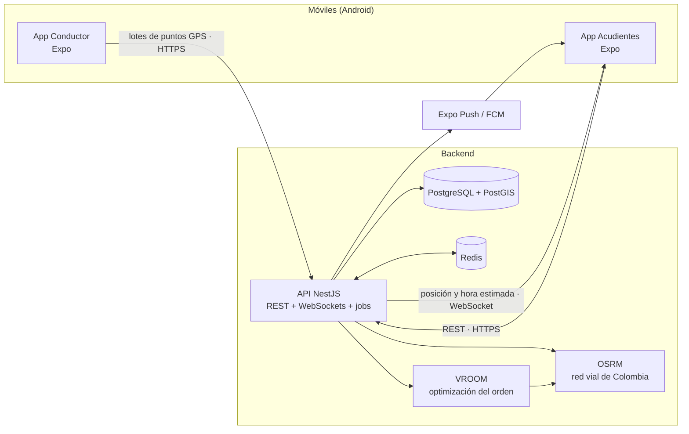

# Enruta2

[](https://github.com/TomasPosada0626/Enruta2/actions/workflows/ci.yml)

> Se escribe **Enruta2** y se pronuncia **"enrutados"**.

Plataforma móvil para **rutas escolares en Colombia**. El conductor recibe el orden óptimo de recogida y comparte su ubicación durante el recorrido; los acudientes ven en vivo dónde va la ruta y **en cuántos minutos llega a su parada**.

## El problema

- Los acudientes no saben dónde va la ruta: esperan en la puerta sin saber si falta 1 minuto o 20, o llaman al conductor mientras maneja.
- El conductor arma el orden de recogida de memoria, y deja de ser eficiente cuando un niño no va o entra uno nuevo.
- Nadie tiene registro de a qué hora se recogió o se entregó cada niño.

"Ver el bus en el mapa" ya lo hacen otras apps. Enruta2 se diferencia en:

1. **Orden óptimo de recogida y de entrega**, con la hora de entrada al colegio como restricción.
2. **"Hoy no va" con recálculo automático:** el acudiente avisa y el orden del conductor se actualiza.
3. **Hora estimada de llegada por parada**, en vivo ("llega en 6 min").
4. **Solo el celular:** no requiere instalar GPS en el vehículo.
5. **Privacidad por diseño:** cada acudiente ve el vehículo y su parada, nunca las direcciones de otras familias.

## Las dos apps

| App                   | Carpeta         | Para quién                             |
| --------------------- | --------------- | -------------------------------------- |
| **Enruta2 Conductor** | `apps/driver`   | Conductor, acompañante y administrador |
| **Enruta2**           | `apps/guardian` | Acudientes (papás, mamás, cuidadores)  |

Son dos apps y no una con roles para que solo la del conductor pida ubicación en segundo plano, el permiso que más revisa Google Play ([ADR 0002](docs/adr/0002-dos-apps-separadas.md)).

## Arquitectura



Más detalle en los [diagramas C4](docs/c4/README.md) y en la [especificación](docs/SPEC.md).

## Stack

| Capa         | Tecnología                                                            |
| ------------ | --------------------------------------------------------------------- |
| Apps móviles | React Native 0.88 con Expo SDK 58 (solo Android en el MVP)            |
| API          | NestJS 12 (ES modules), Swagger, Terminus, pino                       |
| Datos        | PostgreSQL 18 + PostGIS 3.6, Prisma (Fase 1)                          |
| Tiempo real  | Socket.IO con adapter de Redis (Fase 3)                               |
| Optimización | OSRM + VROOM sobre OpenStreetMap (Fase 2)                             |
| Dominio      | `packages/domain`: reglas de negocio puras compartidas por API y apps |
| Calidad      | TypeScript 6 estricto, ESLint, Prettier, Vitest, GitHub Actions       |
| Monorepo     | pnpm workspaces + Turborepo                                           |

Las versiones y sus restricciones están en el [ADR 0009](docs/adr/0009-versiones-base.md).

## Estructura

```
apps/
  api/          API NestJS
  driver/       App Enruta2 Conductor (Expo)
  guardian/     App Enruta2 para acudientes (Expo)
packages/
  config/       Configuración compartida de TypeScript y ESLint
  domain/       Reglas de negocio: roles, recorridos, máquinas de estado
docs/
  SPEC.md       Especificación del producto
  PLAN.md       Plan de acción y avance por fases
  adr/          Decisiones de arquitectura
  c4/           Diagramas de contexto y contenedores
```

## Cómo correrlo

**Requisitos:** Node.js 26, pnpm 9.15 y Docker. Para las apps, la app Expo Go en un celular Android o un emulador de Android Studio.

```bash
pnpm install

# Infraestructura local: PostGIS en el puerto 15432 y Redis en el 6379
pnpm infra:up

# API en http://localhost:3000
cp apps/api/.env.example apps/api/.env
pnpm dev
```

Con la API arriba:

- `GET http://localhost:3000/health/live`: el proceso responde.
- `GET http://localhost:3000/health/ready`: PostgreSQL/PostGIS y Redis responden.
- `http://localhost:3000/docs`: documentación OpenAPI (Swagger).

Las apps se abren con Expo (escanea el código QR con Expo Go):

```bash
pnpm driver     # Enruta2 Conductor, puerto 8081
pnpm guardian   # Enruta2 acudientes, puerto 8082
```

### Scripts

| Comando           | Qué hace                                                         |
| ----------------- | ---------------------------------------------------------------- |
| `pnpm dev`        | API y dominio en modo watch                                      |
| `pnpm check`      | Lint, typecheck, tests y build de todo el monorepo (igual al CI) |
| `pnpm test`       | Tests de todos los paquetes                                      |
| `pnpm format`     | Formatea el código con Prettier                                  |
| `pnpm infra:up`   | Levanta PostGIS y Redis y espera a que estén sanos               |
| `pnpm infra:down` | Detiene la infraestructura local                                 |

## Avance

| Fase                               | Estado    |
| ---------------------------------- | --------- |
| 0. Fundaciones                     | En curso  |
| 1. Datos, autenticación y permisos | Pendiente |
| 2. Paradas y optimización          | Pendiente |
| 3. Recorrido en vivo               | Pendiente |
| 4. Eventos y notificaciones        | Pendiente |
| 5. "Hoy no va" e historial         | Pendiente |
| 6. Calidad y lanzamiento           | Pendiente |

El detalle de cada fase está en el [plan de acción](docs/PLAN.md).

## Privacidad

Enruta2 trata datos de menores de edad, protegidos de forma especial por la Ley 1581 de 2012. Por eso:

- Ningún dato se muestra antes de la autorización expresa del acudiente.
- Un acudiente solo recibe la posición del vehículo, su parada y la hora estimada de su parada.
- La ubicación en vivo solo existe mientras el recorrido está en curso, y los puntos GPS se borran automáticamente.
- Los logs nunca incluyen nombres, direcciones ni cuerpos de petición.
