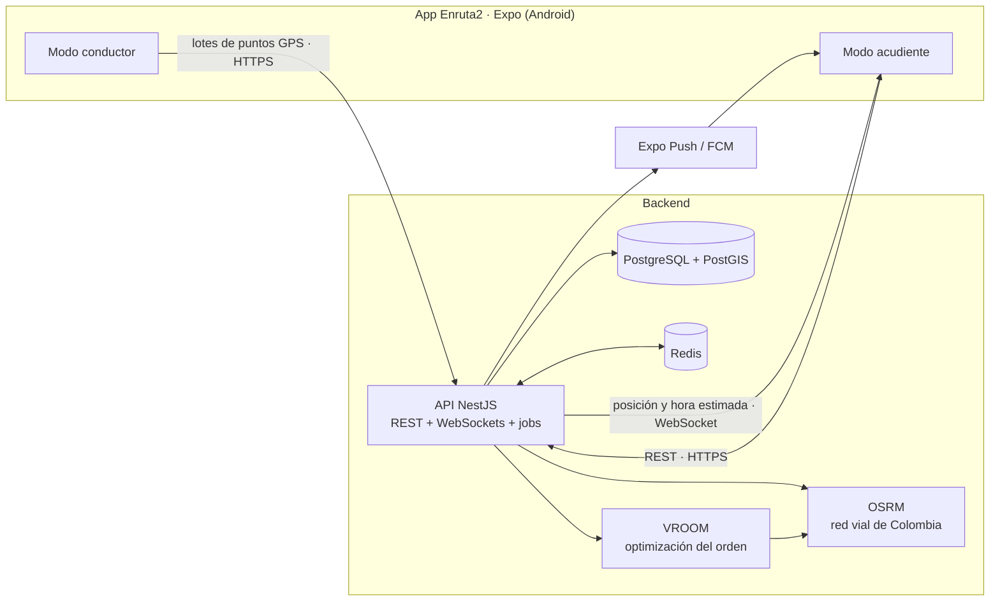

# Enruta2

[](https://github.com/TomasPosada0626/Enruta2/actions/workflows/ci.yml)

> Se escribe **Enruta2** y se pronuncia **"enrutados"**.

Plataforma móvil para **rutas escolares en Colombia**. El conductor recibe el orden óptimo de recogida, navega parada por parada con Waze o Google Maps y comparte su ubicación durante el recorrido; los acudientes ven en vivo dónde va la ruta y **en cuántos minutos llega a su parada**.

## El problema

- Los acudientes no saben dónde va la ruta: esperan en la puerta sin saber si falta 1 minuto o 20, o llaman al conductor mientras maneja.
- El conductor arma el orden de recogida de memoria, y deja de ser eficiente cuando un niño no va o entra uno nuevo.
- Nadie tiene registro de a qué hora se recogió o se entregó cada niño.

"Ver el bus en el mapa" ya lo hacen otras apps. Enruta2 se diferencia en:

1. **Orden óptimo de recogida y de entrega**: la ruta más rápida por todas las paradas.
2. **"Hoy no va" con recálculo automático:** el acudiente avisa, el conductor recibe el aviso al instante y su orden se actualiza.
3. **Hora estimada de llegada por parada**, en vivo ("llega en 6 min").
4. **Solo el celular:** no requiere instalar GPS en el vehículo.
5. **Privacidad por diseño:** cada acudiente ve el vehículo, en qué parada va y cuál es la suya; nunca las direcciones ni los nombres de otras familias.

## Una sola app, dos modos

La app **Enruta2** (`apps/mobile`) pregunta al abrirse "¿Cómo usas Enruta2?" y lleva al inicio de sesión de cada modo:

| Modo          | Para quién                             | Pestañas                                   |
| ------------- | -------------------------------------- | ------------------------------------------ |
| **Acudiente** | Acudientes (papás, mamás, cuidadores)  | En vivo, Hijos, Avisos, Cuenta             |
| **Conductor** | Conductor, acompañante y administrador | Hoy, Recorrido, Inscripciones, Avisos, Más |

Es una sola app para tener un APK, un canal de actualizaciones y una ficha en Google Play. El permiso de ubicación en segundo plano solo se pide en el modo conductor ([ADR 0011](docs/adr/0011-una-app-con-seleccion-de-rol.md)).

## Arquitectura



Más detalle en los [diagramas C4](docs/c4/README.md) y en la [especificación](docs/SPEC.md).

## Stack

| Capa         | Tecnología                                                                                                         |
| ------------ | ------------------------------------------------------------------------------------------------------------------ |
| App móvil    | React Native 0.88 con Expo SDK 58 (solo Android en el MVP); APK con EAS Build y actualizaciones OTA con EAS Update |
| API          | NestJS 12 (ES modules), Swagger, Terminus, pino                                                                    |
| Datos        | PostgreSQL 18 + PostGIS 3.6, Prisma (Fase 1)                                                                       |
| Tiempo real  | Socket.IO con adapter de Redis (Fase 3)                                                                            |
| Optimización | OSRM + VROOM sobre OpenStreetMap (Fase 2)                                                                          |
| Dominio      | `packages/domain`: reglas de negocio puras compartidas por API y app                                               |
| Diseño       | `packages/ui`: tema, logo, íconos y componentes de la app (Hanken Grotesk, expo-router, react-native-svg)          |
| Calidad      | TypeScript 6 estricto, ESLint, Prettier, Vitest, GitHub Actions                                                    |
| Monorepo     | pnpm workspaces + Turborepo                                                                                        |

Las versiones y sus restricciones están en el [ADR 0009](docs/adr/0009-versiones-base.md).

## Estructura

```
apps/
  api/          API NestJS
  mobile/       App Enruta2 (Expo): modo acudiente y modo conductor
packages/
  config/       Configuración compartida de TypeScript y ESLint
  domain/       Reglas de negocio: roles, recorridos, máquinas de estado
  ui/           Diseño de la app: tema, logo, íconos y componentes
infra/
  routing/      OSRM y VROOM: preparación del mapa del Valle de Aburrá y medición
docs/
  SPEC.md       Especificación del producto
  PLAN.md       Plan de acción y avance por fases
  adr/          Decisiones de arquitectura
  c4/           Diagramas de contexto y contenedores
```

## Cómo correrlo

**Requisitos:** Node.js 26, pnpm 9.15 y Docker. Para la app, Expo Go en un celular Android o un emulador de Android Studio.

```bash
pnpm install

# Infraestructura local: PostGIS en el puerto 15432 y Redis en el 6379
pnpm infra:up

# API en http://localhost:3000
cp apps/api/.env.example apps/api/.env
pnpm dev
```

Con la API arriba:

- `GET http://localhost:3000/health/live`: el proceso responde.
- `GET http://localhost:3000/health/ready`: PostgreSQL/PostGIS y Redis responden.
- `http://localhost:3000/docs`: documentación OpenAPI (Swagger).

La app se abre con Expo (escanea el código QR con Expo Go):

```bash
pnpm movil
```

Por ahora la app es un **prototipo navegable** con el diseño final y datos de ejemplo; todavía no se conecta a la API. El celular y el computador deben estar en la misma red Wi-Fi (si no, `pnpm movil --tunnel`). Qué probar:

- **Conductor** («Soy conductor o acompañante»): Entrar → Iniciar recorrido → Abrir en Waze o Google Maps → «Simular llegada» → marcar a cada estudiante → Ir a la siguiente. La vuelta se arma desde «Ruta Norte · Regreso» con la lista de abordaje. La pestaña Inscripciones aprueba las solicitudes, y la pestaña Más tiene atajos de prueba para los avisos de «no va» y de GPS apagado.
- **Acudiente** («Soy acudiente»): Entrar → inicio en vivo (la hora estimada baja sola) → Hoy no va / No regresa / llamar. El selector de arriba cambia de hijo (Pablo y Emma), y la pestaña Hijos muestra la tarjeta de cada uno. «Tengo un enlace o código» (o Inscribir, en Hijos) abre la inscripción: estudiante, dirección, confirmación arrastrando el mapa y días.

### Instalar el APK y actualizar por OTA

La app se compila en la nube con [EAS](https://expo.dev) (proyecto `@pawfound/enruta2`):

```bash
pnpm apk   # compila el APK de prueba (perfil preview); la página del build tiene el QR para instalarlo
pnpm ota   # publica los cambios de JavaScript en el canal preview; el APK los descarga al abrirse
```

Cada push a `main` que cambie la app publica la actualización sola ([`.github/workflows/ota.yml`](.github/workflows/ota.yml)) si el repositorio tiene el secreto `EXPO_TOKEN` (expo.dev → Account settings → Access tokens). Un cambio nativo (un paquete nuevo de Expo, permisos, íconos) no viaja por OTA: hay que subir `version` en `apps/mobile/app.json` y compilar un APK nuevo.

### Scripts

| Comando           | Qué hace                                                         |
| ----------------- | ---------------------------------------------------------------- |
| `pnpm dev`        | API y dominio en modo watch                                      |
| `pnpm check`      | Lint, typecheck, tests y build de todo el monorepo (igual al CI) |
| `pnpm test`       | Tests de todos los paquetes                                      |
| `pnpm format`     | Formatea el código con Prettier                                  |
| `pnpm infra:up`   | Levanta PostGIS y Redis y espera a que estén sanos               |
| `pnpm infra:down` | Detiene la infraestructura local                                 |
| `pnpm movil`      | Abre la app con Expo                                             |
| `pnpm apk`        | Compila el APK de prueba en EAS                                  |
| `pnpm ota`        | Publica una actualización OTA en el canal preview                |

## Avance

| Fase                               | Estado     |
| ---------------------------------- | ---------- |
| 0. Fundaciones                     | Completada |
| 1. Datos, autenticación y permisos | Pendiente  |
| 2. Paradas y optimización          | Pendiente  |
| 3. Recorrido en vivo               | Pendiente  |
| 4. Eventos y notificaciones        | Pendiente  |
| 5. "Hoy no va" e historial         | Pendiente  |
| 6. Calidad y lanzamiento           | Pendiente  |

El detalle de cada fase está en el [plan de acción](docs/PLAN.md).

## Privacidad

Enruta2 trata datos de menores de edad, protegidos de forma especial por la Ley 1581 de 2012. Por eso:

- Ningún dato se muestra antes de la autorización expresa del acudiente.
- Un acudiente solo recibe la posición del vehículo, su parada y la hora estimada de su parada.
- La ubicación en vivo solo existe mientras el recorrido está en curso, y los puntos GPS se borran automáticamente.
- Los logs nunca incluyen nombres, direcciones ni cuerpos de petición.
