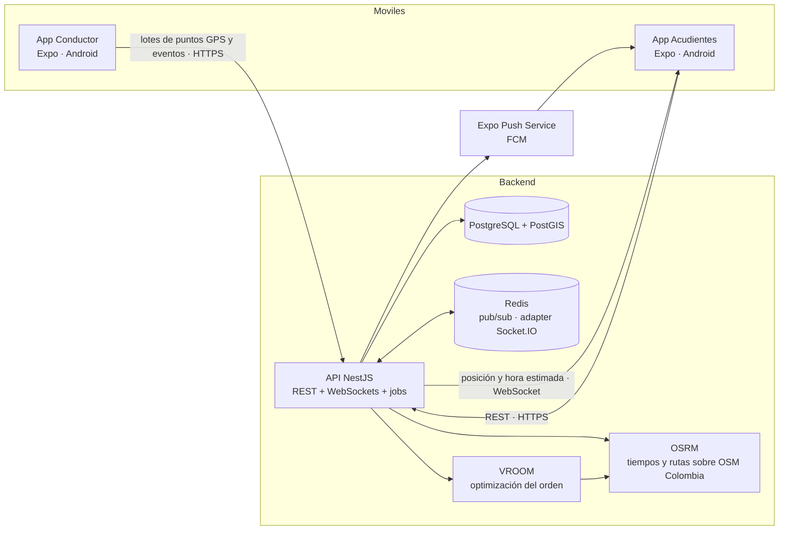

# Enruta2 — Especificación del proyecto

> Se escribe **Enruta2** y se pronuncia **"enrutados"**.
> Documento vivo: actualízalo cuando cambie el alcance, el modelo de datos o una decisión.

---

## 1. Resumen

Enruta2 es una plataforma móvil para **rutas escolares en Colombia** con dos apps:

| App                                   | Para quién                                        | Qué hace                                                                                                                            |
| ------------------------------------- | ------------------------------------------------- | ----------------------------------------------------------------------------------------------------------------------------------- |
| **Enruta2 Conductor** (`apps/driver`) | Conductor, acompañante y administrador de la ruta | Registrar estudiantes y direcciones, calcular el orden óptimo de recogida, hacer el recorrido compartiendo GPS y marcar cada evento |
| **Enruta2** (`apps/guardian`)         | Acudientes (papás, mamás, cuidadores)             | Ver en vivo dónde va la ruta y en cuántos minutos llega, recibir notificaciones y avisar "hoy no va"                                |

Detrás de ambas hay una API en NestJS con PostgreSQL + PostGIS, WebSockets para el tiempo real y un motor de optimización (OSRM + VROOM).

**Por qué dos apps y no una con roles:** la ubicación en segundo plano exige una declaración especial ante Google Play. Separando las apps, solo la del conductor la pide, y la de los acudientes pasa la revisión de Google Play con mucha menos fricción.

---

## 2. Problema y contexto

### 2.1 El problema

- Los acudientes no saben dónde va la ruta. Esperan en la puerta sin saber si falta 1 minuto o 20, o llaman al conductor mientras maneja.
- El conductor arma el orden de recogida "de memoria". Cuando un niño no va o entra uno nuevo, el orden deja de ser eficiente.
- Nadie tiene trazabilidad de a qué hora se recogió o se entregó cada niño.

### 2.2 Competencia

Ya existen apps de seguimiento de rutas escolares en Colombia y la región (Bus esCool, Rutappy School, Mi Buseta, Mi Ruta Segura, Traceus, EnRuta School / EnRutaV2, entre otras). **"Ver el bus en el mapa" ya es un commodity.**

### 2.3 Diferenciadores de Enruta2

1. **Optimización del orden de recogida** (y de entrega en la vuelta), con hora de entrada al colegio como restricción.
2. **"Hoy no va" con recálculo automático:** el acudiente avisa, la parada sale del recorrido y el orden se recalcula.
3. **Hora estimada de llegada en vivo por parada** ("llega en 6 min"), que a los papás les importa más que el mapa.
4. **Solo el celular:** no requiere instalar GPS en el vehículo.
5. **Privacidad por diseño:** cada acudiente ve el vehículo y su parada, nunca las direcciones de otras familias.

### 2.4 Contexto regulatorio (Colombia)

- **Ley 1581 de 2012 (habeas data):** los datos de niños, niñas y adolescentes tienen protección especial; se requiere autorización expresa del representante legal.
- **Decreto 1048 del 5 de agosto de 2026** (vigente desde el 7 de agosto de 2026): actualizó la reglamentación del transporte especial con obligaciones para conductores y acompañantes y sobre la supervisión de los estudiantes. **Tarea pendiente:** leer el decreto y convertir en funcionalidades lo que aplique (por ejemplo, registro del acompañante en cada recorrido).
- El público objetivo son **empresas legales de transporte especial** y sus conductores, no rutas informales.

---

## 3. Usuarios y roles

Los roles son **por organización**: una persona puede ser administradora en una organización y acudiente en otra.

| Rol                     | App        | Puede                                                                                                                                             |
| ----------------------- | ---------- | ------------------------------------------------------------------------------------------------------------------------------------------------- |
| `ADMIN`                 | Conductor  | Gestionar vehículos, rutas, estudiantes, conductores, acompañantes e invitaciones de su organización; ver todos los recorridos de su organización |
| `DRIVER` (conductor)    | Conductor  | Ver sus rutas, iniciar y finalizar recorridos, compartir ubicación, marcar eventos **solo con el vehículo detenido**                              |
| `MONITOR` (acompañante) | Conductor  | Marcar recogido, entregado o ausente; compartir ubicación si el recorrido usa su celular                                                          |
| `GUARDIAN` (acudiente)  | Acudientes | Ver el vehículo en vivo y la hora estimada de su parada, recibir notificaciones, marcar "hoy no va", gestionar su autorización de datos           |

**Caso especial:** un conductor independiente es una organización de una sola persona, con los roles `ADMIN` y `DRIVER` a la vez.

**Implementación:** permisos con CASL, definidos una sola vez en `packages/domain/permissions` y usados tanto en la API (guards de NestJS) como en las apps (mostrar u ocultar acciones). El servidor siempre es la fuente de verdad.

---

## 4. Glosario

| Término                 | Significado                                                                      |
| ----------------------- | -------------------------------------------------------------------------------- |
| **Organización**        | Empresa de transporte (o conductor independiente) dueña de las rutas             |
| **Ruta**                | Plantilla recurrente: vehículo, colegio, jornada, sentido y lista de estudiantes |
| **Jornada**             | `AM` (mañana) o `PM` (tarde)                                                     |
| **Sentido**             | `TO_SCHOOL` (ida: casas → colegio) o `TO_HOME` (vuelta: colegio → casas)         |
| **Recorrido** (`Trip`)  | Una ejecución concreta de una ruta en una fecha                                  |
| **Parada**              | Dirección de un estudiante dentro de una ruta                                    |
| **Acudiente**           | Adulto responsable del estudiante                                                |
| **Acompañante**         | Adulto que va en el vehículo y supervisa a los estudiantes                       |
| **Hora estimada (ETA)** | Minutos que faltan para que el vehículo llegue a una parada                      |

---

## 5. Alcance del MVP

### 5.1 Historias de usuario

**Administrador**

- A1. Como admin, creo mi organización y registro vehículos (placa, capacidad).
- A2. Como admin, creo una ruta con colegio (dirección y punto en el mapa), jornada, sentido, hora de entrada o salida, conductor y acompañante.
- A3. Como admin, agrego estudiantes a una ruta con su dirección. La app geocodifica la dirección y **me pide confirmar o ajustar el pin en el mapa** (las direcciones colombianas tipo "Cra 43A # 1-50" se geocodifican mal con frecuencia).
- A4. Como admin, invito a los acudientes de cada estudiante con un enlace o código.

**Conductor y acompañante**

- C1. Como conductor, veo el orden óptimo de las paradas de la ruta del día, en lista y en mapa, con la hora estimada de llegada al colegio.
- C2. Como conductor, recalculo el orden cuando cambian los estudiantes de la ruta.
- C3. Como conductor, inicio el recorrido; la app comparte la ubicación en segundo plano hasta que lo finalizo, aunque la pantalla esté apagada.
- C4. Como acompañante (o conductor detenido), marco en cada parada **recogido**, **entregado** o **no salió**.
- C5. Como conductor, si pierdo señal, la app guarda los puntos GPS y los eventos y los envía cuando vuelve la conexión.

**Acudiente**

- G1. Como acudiente, acepto la invitación y doy la **autorización expresa** de tratamiento de datos de mi hijo antes de ver cualquier información.
- G2. Como acudiente, veo en un mapa el vehículo en vivo y mi parada, con la hora estimada de llegada.
- G3. Como acudiente, recibo notificaciones: la ruta salió, va llegando (~5 min), llegó, mi hijo fue recogido, llegó al colegio, va de vuelta y llegó a casa.
- G4. Como acudiente, marco **"hoy no va"** para una jornada; la parada sale del recorrido y el conductor ve el orden recalculado.
- G5. Como acudiente, recibo una alerta si la ruta va con retraso significativo.

**Sistema**

- S1. Los puntos GPS se borran automáticamente después de `LOCATION_RETENTION_DAYS`.
- S2. Cada evento de parada guarda **quién** lo marcó y **cuándo**.
- S3. Cada acceso a la ubicación en vivo queda registrado (quién la vio y cuándo).

### 5.2 Fuera del alcance del MVP

- iOS (el código debe quedar preparado, pero no se publica)
- Panel web para empresas y colegios (fase posterior, en Next.js)
- Pagos, facturación y cobro del servicio
- Chat entre acudientes y conductor
- Múltiples vehículos optimizados juntos (VRP multi-vehículo); el MVP optimiza **una ruta = un vehículo**
- Hardware GPS o integración con rastreadores del vehículo

---

## 6. Flujos principales

### 6.1 Ida (`TO_SCHOOL`)

1. Antes de salir, el backend genera el `Trip` del día con las paradas activas (excluye las marcadas "hoy no va") y su orden optimizado.
2. El conductor toca **Iniciar recorrido** → arranca el rastreo en segundo plano → notificación a acudientes: _"La ruta de {nombre} ya salió 🚐"_.
3. Con cada lote de puntos GPS, el backend recalcula la hora estimada por parada y la emite por WebSocket a los acudientes de ese recorrido.
4. Cuando la hora estimada de una parada baja de ~5 min → notificación _"va llegando"_.
5. Cuando el vehículo entra al radio de la parada → estado `ARRIVED`.
6. El acompañante marca **recogido** o **no salió** → notificación al acudiente.
7. Al llegar al colegio → notificación a todos: _"{nombre} llegó al colegio"_.
8. El conductor finaliza el recorrido → se detiene el rastreo y se cierra la sala de tiempo real.

### 6.2 Vuelta (`TO_HOME`)

Igual, pero el vehículo sale del colegio y los eventos son **entregado** y _"llegó a casa 🏠"_.

### 6.3 "Hoy no va"

1. El acudiente marca la ausencia para una fecha y jornada.
2. Si el recorrido no ha empezado: la parada se excluye al generarlo.
3. Si ya empezó y la parada está pendiente: la parada pasa a `EXCUSED`, se recalcula el orden de las restantes y el conductor ve el cambio.
4. Hay una hora de corte configurable (por ejemplo, no se acepta si el vehículo está a menos de 5 min).

### 6.4 Onboarding del acudiente

Invitación (enlace o código) → registro → **autorización de tratamiento de datos** (versionada, con fecha) → vinculación con su estudiante → permiso de notificaciones.

---

## 7. Requisitos no funcionales

### 7.1 Privacidad y seguridad (prioridad máxima)

- Autorización expresa del acudiente guardada con versión del texto y fecha (`Consent`).
- Un acudiente **solo** recibe: posición del vehículo, su parada y la hora estimada de su parada. Nunca la lista de paradas ni direcciones de otros estudiantes.
- La ubicación en vivo solo existe mientras el `Trip` está `IN_PROGRESS`.
- La autorización se valida en el servidor: al unirse a la sala WebSocket y en cada endpoint.
- Registro de accesos a la ubicación en vivo (`LocationAccessLog`).
- Borrado automático de puntos GPS (`LOCATION_RETENTION_DAYS`, propuesta inicial: 7).
- Sin datos de menores en logs. Usar identificadores, no nombres ni coordenadas.
- HTTPS, JWT de acceso corto con refresh rotativo, rate limiting, validación de toda entrada.

### 7.2 Batería y confiabilidad del rastreo

- Frecuencia adaptativa: cada ~5 s o ~25 m en movimiento; menos frecuente detenido.
- Envío por **lotes HTTP con reintento**, no por socket, desde la tarea en segundo plano (los sockets en segundo plano son poco confiables en Android).
- Cola local (SQLite) cuando no hay señal; se envía al reconectar sin perder el orden.
- Servicio en primer plano de Android con notificación fija ("Recorrido activo") mientras dura el recorrido.

### 7.3 Rendimiento

- Hora estimada recalculada como máximo cada ~30 s por recorrido.
- Notificación de "va llegando" con un margen de error objetivo de ±2 min (se mide en el piloto).

### 7.4 Observabilidad

- Logs JSON estructurados con identificador de correlación (pino).
- `/health/live` y `/health/ready` (NestJS Terminus: base de datos, Redis, OSRM, VROOM).
- Métricas Prometheus: recorridos activos, puntos GPS ingeridos, latencia del cálculo de hora estimada, notificaciones enviadas y fallidas, duración de la optimización.
- Tableros de Grafana versionados en `infra/grafana`.

---

## 8. Arquitectura

### 8.1 Contenedores (C4 nivel 2)



### 8.2 Módulos de la API (NestJS)

| Módulo               | Responsabilidad                                                            |
| -------------------- | -------------------------------------------------------------------------- |
| `auth`               | Registro, login, JWT, refresh, invitaciones                                |
| `organizations`      | Organizaciones y membresías con rol                                        |
| `fleet`              | Vehículos                                                                  |
| `routes`             | Rutas, estudiantes, paradas, acudientes vinculados                         |
| `geocoding`          | Geocodificación de direcciones (proveedor detrás de una interfaz)          |
| `optimization`       | Cliente de VROOM/OSRM; heurística de respaldo desde `packages/domain`      |
| `trips`              | Generación diaria de recorridos, inicio/fin, máquina de estados de paradas |
| `tracking`           | Ingesta de puntos GPS, cálculo de hora estimada, gateway WebSocket         |
| `absences`           | "Hoy no va" y recálculo                                                    |
| `notifications`      | Catálogo de mensajes y envío por Expo Push                                 |
| `consents`           | Autorizaciones de tratamiento de datos                                     |
| `retention`          | Job programado de borrado de datos                                         |
| `health` / `metrics` | Health checks y métricas                                                   |

---

## 9. Stack y decisiones

| Decisión         | Elección                                      | Alternativas consideradas   | Razón                                                                                                              |
| ---------------- | --------------------------------------------- | --------------------------- | ------------------------------------------------------------------------------------------------------------------ |
| Plataforma móvil | React Native + Expo, solo Android en el MVP   | PWA, Flutter, nativo        | TypeScript de punta a punta; el MVP necesita GPS en segundo plano, notificaciones y cámara, que una PWA no da bien |
| Número de apps   | Dos (conductor y acudientes)                  | Una con roles               | Aísla el permiso de ubicación en segundo plano en una sola app                                                     |
| Backend          | NestJS + PostgreSQL + PostGIS + Prisma        | Express, Drizzle            | Estructura modular, buen soporte de WebSockets y OpenAPI                                                           |
| Tiempo real      | Socket.IO + Redis adapter                     | Firebase, Supabase Realtime | Control total de la autorización por sala; escala horizontal con Redis                                             |
| Optimización     | OSRM + VROOM (Docker)                         | Google Routes API, OR-Tools | Código abierto, sin costo por uso, soporta ventanas de tiempo y rutas abiertas                                     |
| Mapas en la app  | `react-native-maps` (Google en Android)       | MapLibre                    | Más rápido de integrar. Confirmar precios vigentes del SDK de mapas en el ADR                                      |
| Geocodificación  | Detrás de una interfaz; proveedor por decidir | Google Geocoding, Nominatim | Las direcciones colombianas exigen confirmar el pin manualmente en cualquier caso                                  |
| Permisos         | CASL                                          | Chequeos manuales por rol   | Reglas declarativas compartidas entre API y apps                                                                   |
| Monorepo         | pnpm + Turborepo                              | Nx                          | Simple y rápido                                                                                                    |

### 9.1 ADRs iniciales

| #    | Título                                                            |
| ---- | ----------------------------------------------------------------- |
| 0001 | Expo y Android como única plataforma del MVP                      |
| 0002 | Dos apps separadas en vez de una con roles                        |
| 0003 | Estrategia de ubicación en segundo plano e ingesta por lotes HTTP |
| 0004 | Motor de optimización: OSRM + VROOM                               |
| 0005 | Tiempo real con Socket.IO y Redis                                 |
| 0006 | Permisos con CASL compartidos en `packages/domain`                |
| 0007 | PostGIS con Prisma usando `Unsupported` + SQL crudo encapsulado   |
| 0008 | Proveedor de mapas y de geocodificación                           |

---

## 10. Modelo de datos (borrador)

> Columnas geográficas: `geography(Point, 4326)`, declaradas en Prisma como `Unsupported(...)`.
> Toda tabla tiene `id` (UUID), `createdAt`, `updatedAt`. Las acciones de usuario guardan `createdById`.

| Entidad             | Campos clave                                                                                                                                                             | Notas                                                  |
| ------------------- | ------------------------------------------------------------------------------------------------------------------------------------------------------------------------ | ------------------------------------------------------ |
| `Organization`      | name, nit (opcional)                                                                                                                                                     | Empresa o conductor independiente                      |
| `User`              | email, passwordHash, fullName, phone                                                                                                                                     |                                                        |
| `Membership`        | userId, organizationId, role (`ADMIN`/`DRIVER`/`MONITOR`/`GUARDIAN`)                                                                                                     | Roles por organización                                 |
| `Vehicle`           | organizationId, plate, capacity                                                                                                                                          |                                                        |
| `School`            | organizationId, name, addressText, location                                                                                                                              |                                                        |
| `Route`             | organizationId, schoolId, vehicleId, name, shift (`AM`/`PM`), direction (`TO_SCHOOL`/`TO_HOME`), schoolTime, defaultDriverId, defaultMonitorId, startLocation (opcional) | Plantilla recurrente                                   |
| `Student`           | organizationId, firstName, lastName                                                                                                                                      | Mínimo de datos necesarios                             |
| `StudentGuardian`   | studentId, userId (acudiente), relationship                                                                                                                              |                                                        |
| `Stop`              | routeId, studentId, addressText, location, confirmedAt, serviceSeconds                                                                                                   | `location` confirmada por el usuario                   |
| `RouteOptimization` | routeId, orderedStopIds, totalDurationSec, totalDistanceM, feasible, computedAt, engine (`VROOM`/`HEURISTIC`)                                                            | Historial de cálculos                                  |
| `Trip`              | routeId, date, status (`SCHEDULED`/`IN_PROGRESS`/`COMPLETED`/`CANCELLED`), trackingUserId, startedAt, endedAt                                                            | Una ejecución de la ruta                               |
| `TripStop`          | tripId, stopId, sequence, status, etaAt, arrivedAt, completedAt, completedById                                                                                           | Estado por parada en el recorrido                      |
| `LocationPing`      | tripId, location, speed, heading, accuracy, recordedAt, receivedAt                                                                                                       | Se borra por retención; considerar partición por fecha |
| `Absence`           | studentId, date, shift, createdById                                                                                                                                      | "Hoy no va"                                            |
| `Consent`           | guardianUserId, studentId, textVersion, acceptedAt, revokedAt                                                                                                            | Autorización Ley 1581                                  |
| `PushToken`         | userId, token, platform, lastSeenAt                                                                                                                                      |                                                        |
| `NotificationLog`   | userId, tripId, type, sentAt, status                                                                                                                                     |                                                        |
| `LocationAccessLog` | userId, tripId, accessedAt                                                                                                                                               | Quién vio la ubicación en vivo                         |

### 10.1 Máquinas de estado (en `packages/domain`)

**Trip:** `SCHEDULED → IN_PROGRESS → COMPLETED` (o `CANCELLED` desde `SCHEDULED`).

**TripStop:**

```
PENDING → APPROACHING → ARRIVED → PICKED_UP   (ida)
                               → DROPPED_OFF  (vuelta)
                               → NO_SHOW      (el niño no salió / nadie recibió)
PENDING → EXCUSED  ("hoy no va")
```

Las transiciones inválidas se rechazan con error de dominio. Cada transición registra quién y cuándo.

---

## 11. API (borrador)

### 11.1 REST

| Método              | Ruta                                             | Rol                                             |
| ------------------- | ------------------------------------------------ | ----------------------------------------------- |
| `POST`              | `/auth/register`, `/auth/login`, `/auth/refresh` | Público                                         |
| `POST`              | `/invitations/:code/accept`                      | Autenticado                                     |
| `POST/GET/PATCH`    | `/organizations/:orgId/vehicles`                 | ADMIN                                           |
| `POST/GET/PATCH`    | `/organizations/:orgId/routes`                   | ADMIN (lectura: DRIVER, MONITOR)                |
| `POST/PATCH/DELETE` | `/routes/:routeId/stops`                         | ADMIN                                           |
| `POST`              | `/geocoding/search`                              | ADMIN                                           |
| `POST`              | `/routes/:routeId/optimize`                      | ADMIN, DRIVER                                   |
| `GET`               | `/me/trips/today`                                | DRIVER, MONITOR, GUARDIAN (cada uno ve lo suyo) |
| `POST`              | `/trips/:tripId/start`, `/trips/:tripId/finish`  | DRIVER                                          |
| `POST`              | `/trips/:tripId/locations` (lote)                | Usuario que hace el rastreo                     |
| `POST`              | `/trips/:tripId/stops/:tripStopId/events`        | MONITOR, DRIVER                                 |
| `POST/DELETE`       | `/students/:studentId/absences`                  | GUARDIAN del estudiante, ADMIN                  |
| `GET`               | `/guardian/trips/:tripId/live`                   | GUARDIAN del estudiante en ese recorrido        |
| `POST`              | `/consents`                                      | GUARDIAN                                        |
| `POST`              | `/me/push-tokens`                                | Autenticado                                     |

### 11.2 WebSocket (`/live`)

| Evento             | Dirección          | Contenido                                                                       |
| ------------------ | ------------------ | ------------------------------------------------------------------------------- |
| `trip:join`        | cliente → servidor | `tripId`. El servidor valida que el usuario tenga un estudiante en el recorrido |
| `trip:position`    | servidor → cliente | Posición del vehículo, rumbo, momento                                           |
| `trip:eta`         | servidor → cliente | **Solo** la hora estimada de la parada del acudiente                            |
| `trip:stop-status` | servidor → cliente | Estado de **su** parada                                                         |
| `trip:ended`       | servidor → cliente | Fin del recorrido; el cliente deja de mostrar la ubicación                      |

Al conductor y al admin se les emite la vista completa (todas las paradas) en una sala distinta.

---

## 12. Algoritmos

### 12.1 Optimización del orden

- **Problema:** viajante con ventanas de tiempo para **un vehículo** (TSP-TW), resuelto con VROOM sobre la matriz de tiempos de OSRM.
- **Ida:** inicio en `Route.startLocation` (o la primera parada), una tarea por parada con tiempo de servicio y **fin en el colegio**, sin ventana de tiempo en el vehículo.
- **Vuelta:** inicio en el colegio, una tarea por parada, **ruta abierta** (sin punto final).
- **Viabilidad:** VROOM no avisa cuando la hora de entrada es imposible; deja paradas sin asignar ([ADR 0004](adr/0004-osrm-vroom.md)). Por eso se calcula el orden de menor duración con todas las paradas y, si la llegada al colegio supera la hora de entrada menos un margen → `feasible = false` y aviso: _"Con estas paradas la ruta no alcanza a llegar a tiempo"_.
- **Respaldo:** heurística en `packages/domain` (vecino más cercano + 2-opt) para cuando VROOM no esté disponible. Sus tests comparan la calidad contra VROOM en casos de prueba.
- **Recálculo:** al cambiar estudiantes de la ruta o con un "hoy no va" durante un recorrido (solo sobre las paradas pendientes, desde la posición actual).

### 12.2 Hora estimada (ETA)

- Con cada lote de puntos (máximo una vez cada ~30 s por recorrido): pedir a OSRM la ruta desde la posición actual por las paradas pendientes en orden, acumular duraciones y sumar el tiempo de servicio de cada parada.
- Suavizar para evitar saltos bruscos (por ejemplo, promedio móvil exponencial).

### 12.3 Detección de eventos

- `APPROACHING`: hora estimada ≤ `APPROACHING_THRESHOLD_MIN` (por defecto 5).
- `ARRIVED`: distancia a la parada ≤ `ARRIVAL_RADIUS_M` (por defecto 60) y velocidad baja.
- La detección se hace **en el servidor**, a partir de los puntos GPS, no con geocercas del celular.
- Retraso: si la hora estimada de llegada al colegio supera la hora objetivo en más de `DELAY_THRESHOLD_MIN` (por defecto 10) → alerta a acudientes.
- Cada notificación se envía **una sola vez** por parada y recorrido (idempotencia).

---

## 13. Notificaciones

Tono **cercano y cálido**, en español de Colombia. `{nombre}` es el nombre del estudiante.

| Evento             | Mensaje                                                        |
| ------------------ | -------------------------------------------------------------- |
| Recorrido iniciado | La ruta de {nombre} ya salió 🚐                                |
| Va llegando        | La ruta está a unos 5 minutos. ¡Alisten el morral!             |
| Llegó a la parada  | La ruta llegó por {nombre}.                                    |
| Recogido           | {nombre} ya va en la ruta ✅                                   |
| Llegó al colegio   | {nombre} llegó al colegio.                                     |
| Va de vuelta       | {nombre} va de vuelta a casa.                                  |
| Entregado          | {nombre} llegó a casa 🏠                                       |
| No salió           | La ruta pasó y {nombre} no salió. Comunícate con el conductor. |
| Retraso            | La ruta va con unos {minutos} minutos de retraso.              |

---

## 14. Cumplimiento y publicación en Google Play

### 14.1 Ubicación en segundo plano (solo `apps/driver`)

- Google Play solo la permite cuando aporta un beneficio significativo y es parte de la función central de la app.
- Requiere el **formulario de declaración de permisos** en Play Console, con **video** que muestre la función.
- Requiere un **aviso visible dentro de la app** (pantalla bloqueante) **antes** de pedir el permiso, explicando qué se recoge y para qué.
- La política de privacidad debe mencionar explícitamente la ubicación, dentro de la app y en la ficha de la tienda.
- La revisión puede tardar más de lo normal; planear con margen.

### 14.2 Cuenta de desarrollador

- Cuenta personal: pago único de USD 25.
- Las cuentas personales nuevas deben hacer una **prueba cerrada con mínimo 12 testers inscritos durante 14 días continuos** antes de poder publicar en producción.
- Plan: usar como testers a los acudientes de la ruta piloto (cumple el requisito y valida el producto al mismo tiempo).

### 14.3 Otros requisitos

- Formulario de seguridad de datos (_Data safety_) en Play Console.
- Política de privacidad pública, con capítulo de datos de menores.
- **El identificador de cada app no se puede cambiar después de publicar.** Propuesta, a confirmar: `co.enruta2.driver` y `co.enruta2.guardian`.

---

## 15. Estándar de calidad (portafolio)

El proyecto debe poder defenderse en una entrevista técnica. Debe incluir:

- [ ] README profesional (problema, demo, arquitectura, cómo correrlo)
- [ ] Diagramas C4 (contexto y contenedores) en `docs/c4`
- [ ] ADRs en `docs/adr`
- [ ] Docker Compose para levantar todo el backend localmente
- [ ] GitHub Actions: lint, typecheck, tests y build en cada PR
- [ ] Tests: unitarios en `packages/domain` (cobertura alta), integración de la API con Testcontainers (PostgreSQL + PostGIS)
- [ ] OpenAPI (Swagger) de toda la API
- [ ] Migraciones versionadas con Prisma Migrate
- [ ] Logs estructurados, health checks y métricas Prometheus con tableros de Grafana
- [ ] Control de acceso por roles (CASL)
- [ ] Prueba de carga de la ingesta de puntos GPS con k6 (fase final)

---

## 16. Roadmap por fases

Cada fase termina con su criterio de aceptación cumplido y los tests en verde.

### Fase 0 — Fundaciones

- Monorepo (pnpm + Turborepo), `packages/config`, TypeScript strict, ESLint, Prettier.
- Docker Compose con PostGIS y Redis.
- API NestJS mínima con `/health/live` y `/health/ready`, logs JSON y Swagger.
- Las dos apps Expo creadas y corriendo en emulador Android.
- GitHub Actions con lint, typecheck y tests.
- ADRs 0001 a 0003.

**Aceptación:** `pnpm install && pnpm test` funciona en limpio; CI en verde; ambas apps abren en Android.

### Fase 1 — Datos, autenticación y permisos

- Esquema Prisma inicial (sección 10) con migraciones.
- Registro, login, JWT con refresh rotativo e invitaciones.
- Organizaciones, membresías y permisos CASL en `packages/domain`.
- CRUD de vehículos, colegios, rutas y estudiantes; vinculación de acudientes; autorización de datos.

**Aceptación:** tests de integración demuestran que un acudiente no puede leer datos de estudiantes que no son suyos.

### Fase 2 — Paradas y optimización

- Geocodificación detrás de una interfaz y confirmación del pin en el mapa (app del conductor).
- OSRM con el Valle de Aburrá (recorte del extracto de Colombia de OpenStreetMap) y VROOM en Docker. Ya montados en la Etapa 1 del plan (`infra/routing`); en esta fase la API los empieza a usar.
- Endpoint de optimización para ida y vuelta, con aviso de inviabilidad.
- Heurística de respaldo en `packages/domain` con tests.
- Lista y mapa del orden óptimo en la app del conductor.

**Aceptación:** con 15 paradas reales de prueba en Medellín, el orden se calcula en menos de 2 s y respeta la hora de entrada.

### Fase 3 — Recorrido en vivo

- Generación diaria de recorridos.
- Iniciar y finalizar recorrido; rastreo en segundo plano con servicio en primer plano, cola local SQLite e ingesta por lotes.
- Gateway WebSocket con salas autorizadas y Redis adapter.
- Cálculo de hora estimada.
- Mapa en vivo en la app de acudientes (vehículo + su parada, nada más).

**Aceptación:** con la pantalla apagada durante 30 min, el rastreo no se interrumpe; un acudiente de otro recorrido no puede unirse a la sala.

### Fase 4 — Eventos y notificaciones

- Máquina de estados de paradas en `packages/domain`.
- Detección de "va llegando" y "llegó" en el servidor.
- Marcado de recogido, entregado y no salió (acompañante).
- Notificaciones push con el catálogo de la sección 13, idempotentes.
- Alertas de retraso.

**Aceptación:** en una simulación de recorrido, cada acudiente recibe exactamente una notificación por evento.

### Fase 5 — "Hoy no va" e historial

- Ausencias con hora de corte; recálculo durante el recorrido.
- Historial de recorridos (horas de paso por parada).
- Job de retención de datos y registro de accesos a la ubicación.

**Aceptación:** marcar "hoy no va" con el recorrido en curso actualiza el orden del conductor en menos de 5 s.

### Fase 6 — Calidad y lanzamiento

- Métricas Prometheus y tableros de Grafana.
- Prueba de carga con k6 (meta inicial: 200 recorridos simultáneos con un punto cada 5 s).
- Revisión de seguridad y privacidad.
- Cumplimiento de Google Play: aviso visible, video de ubicación en segundo plano, seguridad de datos, política de privacidad.
- Prueba cerrada con 12+ testers durante 14 días.

**Aceptación:** apps aprobadas para producción en Google Play.

---

## 17. Plan de validación (piloto)

Una ruta real (idealmente de una empresa legal de transporte especial), durante al menos 2 semanas.

| Métrica                   | Cómo se mide                                                        |
| ------------------------- | ------------------------------------------------------------------- |
| Error de la hora estimada | Diferencia entre la hora estimada 5 min antes y la llegada real     |
| Minutos ahorrados         | Duración del recorrido con el orden de la app vs. el orden habitual |
| Notificaciones a tiempo   | % de "va llegando" enviadas entre 3 y 7 min antes de la llegada     |
| Uso de los acudientes     | Aperturas por día y por acudiente                                   |
| Estabilidad               | % de sesiones sin fallos; recorridos sin cortes de rastreo          |

---

## 18. Decisiones abiertas

1. Método de autenticación de acudientes: correo y contraseña (MVP) o código por SMS/WhatsApp (más fácil para papás, pero con costo).
2. Proveedor de geocodificación y de mapas (ADR 0008), con precios verificados.
3. Días de retención de puntos GPS y de eventos de parada (validar con la Ley 1581).
4. Hora de corte para "hoy no va".
5. Obligaciones del Decreto 1048 de 2026 que deben convertirse en funcionalidades.
6. Identificadores definitivos de las apps en Google Play.
7. Modelo de negocio, si el piloto funciona (cobro a la empresa de transporte por vehículo, por ejemplo).

---

## 19. Referencias

- Expo Location: https://docs.expo.dev/versions/latest/sdk/location/
- Expo Notifications: https://docs.expo.dev/push-notifications/overview/
- Google Play — ubicación en segundo plano: https://support.google.com/googleplay/android-developer/answer/9799150
- Google Play — requisitos de prueba para cuentas personales nuevas: https://support.google.com/googleplay/android-developer/answer/14151465
- OSRM: https://github.com/Project-OSRM/osrm-backend
- VROOM: https://github.com/VROOM-Project/vroom
- Extracto de OpenStreetMap de Colombia (Geofabrik): https://download.geofabrik.de/south-america/colombia.html
- PostGIS: https://postgis.net/documentation/
- NestJS: https://docs.nestjs.com
- Prisma: https://www.prisma.io/docs
- Socket.IO Redis adapter: https://socket.io/docs/v4/redis-adapter/
- CASL: https://casl.js.org
- Testcontainers: https://testcontainers.com
- k6: https://grafana.com/docs/k6/latest/
- Modelo C4: https://c4model.com
- ADRs con MADR: https://adr.github.io/madr/
- Decreto 1048 de 2026 (nota de prensa): https://newsroom.rcnradio.com/colombia/rutas-escolares-en-colombia-tendran-nuevos-requisitos-para-el-transporte-de-menores
- Ley 1581 de 2012 (protección de datos personales): consultar el texto oficial en el sitio de la Función Pública o de la SIC
