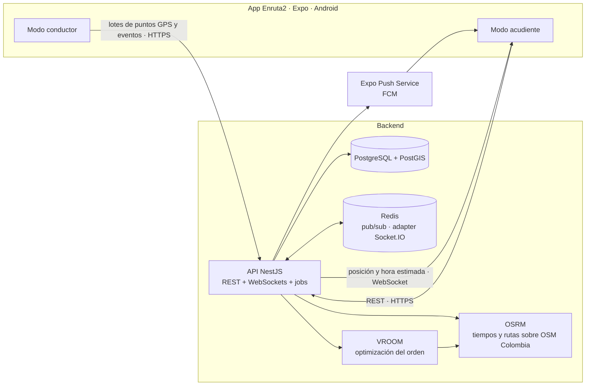

# Enruta2 — Especificación del proyecto

> Se escribe **Enruta2** y se pronuncia **"enrutados"**.
> Documento vivo: actualízalo cuando cambie el alcance, el modelo de datos o una decisión.

---

## 1. Resumen

Enruta2 es una plataforma móvil para **rutas escolares en Colombia**: una sola app (`apps/mobile`) que al abrirse pregunta "¿Cómo usas Enruta2?" y entra en uno de dos modos:

| Modo          | Para quién                                        | Qué hace                                                                                                                                                                                 |
| ------------- | ------------------------------------------------- | ---------------------------------------------------------------------------------------------------------------------------------------------------------------------------------------- |
| **Conductor** | Conductor, acompañante y administrador de la ruta | Registrar estudiantes y direcciones, calcular el orden óptimo de recogida, hacer el recorrido parada por parada (navegando con Waze o Google Maps) compartiendo GPS y marcar cada parada |
| **Acudiente** | Acudientes (papás, mamás, cuidadores)             | Ver en vivo dónde va la ruta y en cuántos minutos llega, recibir notificaciones y avisar "hoy no va"                                                                                     |

Detrás de los dos modos hay una API en NestJS con PostgreSQL + PostGIS, WebSockets para el tiempo real y un motor de optimización (OSRM + VROOM).

**Por qué una sola app:** un APK, un canal de actualizaciones y una ficha en Google Play, con una sola prueba cerrada. El permiso de ubicación solo se pide en el modo conductor ([ADR 0011](adr/0011-una-app-con-seleccion-de-rol.md), que reemplaza al ADR 0002).

---

## 2. Problema y contexto

### 2.1 El problema

- Los acudientes no saben dónde va la ruta. Esperan en la puerta sin saber si falta 1 minuto o 20, o llaman al conductor mientras maneja.
- El conductor arma el orden de recogida "de memoria". Cuando un niño no va o entra uno nuevo, el orden deja de ser eficiente.
- Nadie tiene trazabilidad de a qué hora se recogió o se entregó cada niño.

### 2.2 Competencia

Ya existen apps de seguimiento de rutas escolares en Colombia y la región (Bus esCool, Rutappy School, Mi Buseta, Mi Ruta Segura, Traceus, EnRuta School / EnRutaV2, entre otras). **"Ver el bus en el mapa" ya es un commodity.**

### 2.3 Diferenciadores de Enruta2

1. **Optimización del orden de recogida** (y de entrega en la vuelta): la ruta más rápida por todas las paradas.
2. **"Hoy no va" con recálculo automático:** el acudiente avisa, el conductor recibe el aviso al instante (aunque vaya en camino a esa parada), la parada sale del recorrido y el orden se recalcula.
3. **Hora estimada de llegada en vivo por parada** ("llega en 6 min"), que a los papás les importa más que el mapa.
4. **Solo el celular:** no requiere instalar GPS en el vehículo, y el conductor navega con la app que ya usa (Waze o Google Maps).
5. **Privacidad por diseño:** cada acudiente ve el vehículo, en qué parada va y cuál es la suya; nunca las direcciones ni los nombres de otras familias.

### 2.4 Contexto regulatorio (Colombia)

- **Ley 1581 de 2012 (habeas data):** los datos de niños, niñas y adolescentes tienen protección especial; se requiere autorización expresa del representante legal.
- **Decreto 1048 del 5 de agosto de 2026** (vigente desde el 7 de agosto de 2026): actualizó la reglamentación del transporte especial con obligaciones para conductores y acompañantes y sobre la supervisión de los estudiantes. **Tarea pendiente:** leer el decreto y convertir en funcionalidades lo que aplique (por ejemplo, registro del acompañante en cada recorrido).
- El público objetivo son **empresas legales de transporte especial** y sus conductores, no rutas informales.

---

## 3. Usuarios y roles

Los roles son **por organización**: una persona puede ser administradora en una organización y acudiente en otra.

| Rol                     | App        | Puede                                                                                                                                                                                                                              |
| ----------------------- | ---------- | ---------------------------------------------------------------------------------------------------------------------------------------------------------------------------------------------------------------------------------- |
| `ADMIN`                 | Conductor  | Gestionar vehículos, rutas, conductores y acompañantes de su organización; aprobar inscripciones; ver todos los recorridos de su organización                                                                                      |
| `DRIVER` (conductor)    | Conductor  | Ver sus rutas, armar la vuelta con la lista de abordaje, iniciar y finalizar recorridos, compartir ubicación, marcar cada parada **solo estando en la dirección**                                                                  |
| `MONITOR` (acompañante) | Conductor  | Marcar recogido, entregado o no salió; compartir ubicación si el recorrido usa su celular                                                                                                                                          |
| `GUARDIAN` (acudiente)  | Acudientes | Inscribir a sus hijos en una ruta, ver el vehículo en vivo, en qué parada va y la hora estimada de su parada, recibir notificaciones, marcar "hoy no va", llamar al conductor o al acompañante, gestionar su autorización de datos |

**Caso especial:** un conductor independiente es una organización de una sola persona, con los roles `ADMIN` y `DRIVER` a la vez.

**Implementación:** permisos con CASL, definidos una sola vez en `packages/domain/permissions` y usados tanto en la API (guards de NestJS) como en las apps (mostrar u ocultar acciones). El servidor siempre es la fuente de verdad.

---

## 4. Glosario

| Término                 | Significado                                                                                     |
| ----------------------- | ----------------------------------------------------------------------------------------------- |
| **Organización**        | Empresa de transporte (o conductor independiente) dueña de las rutas                            |
| **Ruta**                | Servicio recurrente de un vehículo a un colegio en una jornada, de ida y de vuelta              |
| **Jornada**             | `AM` (mañana) o `PM` (tarde)                                                                    |
| **Sentido**             | `TO_SCHOOL` (ida: casas → colegio) o `TO_HOME` (vuelta: colegio → casas)                        |
| **Inscripción**         | Qué estudiante va en qué ruta, en qué sentido, a qué dirección y qué días de la semana          |
| **Dirección**           | La dirección exacta que escribe el acudiente, con la ubicación que él mismo confirma en el mapa |
| **Recorrido** (`Trip`)  | Una ejecución de una ruta en una fecha y un sentido                                             |
| **Parada**              | Punto donde se recoge o se deja a uno o más estudiantes (hermanos o vecinos con el mismo pin)   |
| **Lista de abordaje**   | En la vuelta, la lista donde el conductor toca a cada estudiante que sube                       |
| **Acudiente**           | Adulto responsable del estudiante                                                               |
| **Acompañante**         | Adulto que va en el vehículo y supervisa a los estudiantes                                      |
| **Hora estimada (ETA)** | Minutos que faltan para que el vehículo llegue a una parada                                     |

---

## 5. Alcance del MVP

### 5.1 Historias de usuario

**Administrador**

- A1. Como admin, creo mi organización y registro vehículos (placa, capacidad).
- A2. Como admin, creo una ruta **sin direcciones de estudiantes**: colegio (con su pin), jornada, días de servicio, vehículo, conductor, acompañante y horas aproximadas de salida (informativas). Sirve para la ida y para la vuelta, y queda con un **enlace y un código** para invitar.
- A3. Como admin, comparto el enlace o el código de la ruta, por ejemplo en el grupo de WhatsApp de los papás.
- A4. Como admin, apruebo o rechazo cada inscripción: veo la dirección y la ubicación que confirmó el acudiente, y la app no me deja aprobar un día en que el vehículo quede sin cupo. La ubicación no la toco: es la que confirmó el acudiente.

En el texto, "admin" incluye al conductor independiente, que tiene los dos roles.

**Conductor y acompañante**

- C1. Como conductor, veo el orden óptimo de las paradas de la ruta del día, en lista y en mapa, con la hora estimada de llegada a cada parada.
- C2. Como conductor, en la vuelta armo el recorrido con la **lista de abordaje**: toco a cada estudiante que sube y luego **Armar ruta**.
- C3. Como conductor, inicio el recorrido; la app comparte la ubicación en segundo plano hasta que lo finalizo, aunque la pantalla esté apagada o Waze o Google Maps esté en primer plano.
- C4. Como conductor o acompañante, marco en cada parada **recogido**, **entregado** o **no salió**. La app solo lo permite cuando el GPS confirma que estamos en la dirección, o con un motivo si la posición no coincide con el pin; siempre con el GPS activo.
- C5. Como conductor, si pierdo señal, la app guarda los puntos GPS y los eventos y los envía cuando vuelve la conexión.
- C6. Como conductor, al iniciar el recorrido elijo **Waze** o **Google Maps** y navego **una parada a la vez**: la app abre la navegación hacia la parada, me avisa cuando llego para volver a Enruta2 y, después de marcarla, habilita **Ir a la siguiente**.
- C7. Como conductor, recibo un aviso cada vez que un acudiente marca "hoy no va" (_"Pablo no va hoy"_, o _"Pablo no va hoy y tampoco regresa"_). Si voy en camino a esa parada, sigo de una vez a la siguiente desde donde estoy.

**Acudiente**

- G1. Como acudiente, abro el enlace o pongo el código de la ruta, creo mi cuenta con **correo y contraseña** y doy la **autorización expresa** de tratamiento de datos de mi hijo antes de cualquier otra cosa.
- G2. Como acudiente, veo en un mapa el vehículo en vivo y mi parada, la hora estimada de llegada a mi parada y en qué parada va el recorrido (_"va en la 3 de 12; la tuya es la 7"_), sin saber quién se recogió o se entregó en las demás. Lo veo desde que sale la ruta hasta que dejan a mi hijo.
- G3. Como acudiente, recibo notificaciones: la ruta salió, **va en camino a mi dirección** (con la hora estimada), va llegando (~5 min), llegó (automático, por GPS), mi hijo fue recogido, llegó al colegio, va de vuelta y llegó a casa.
- G4. Como acudiente, marco **"hoy no va"** para la ida, incluso con el recorrido en curso. La app me pregunta _"¿Confirmas que Pablo no va hoy?"_, con la casilla **Tampoco regresa** para sacarlo también de la vuelta. La parada sale del recorrido, el conductor recibe el aviso y ve el orden recalculado.
- G5. Como acudiente, marco **"no regresa en la ruta"** cuando mi hijo sí fue a la ida pero no vuelve en la ruta (por ejemplo, si lo recojo en el colegio), hasta que la ruta salga del colegio.
- G6. Como acudiente, llamo con un botón al conductor o al acompañante de la ruta de mi hijo.
- G7. Como acudiente, inscribo a mi hijo: su nombre, la **dirección exacta** donde lo recogen y lo dejan, que **confirmo en el mapa** (_"¿Aquí recogen a Pablo?"_), y los días de ida y de vuelta. Esa ubicación queda confirmada para el conductor. Mi hijo puede tener varias direcciones y rutas distintas según el día (por ejemplo, la casa de la mamá y la del papá).
- G8. Como acudiente principal (el que inscribió a mi hijo), agrego a otro acudiente: le envío un enlace para que se registre y vea a mi hijo en su app, sin duplicar al estudiante.

**Sistema**

- S1. Los puntos GPS se borran automáticamente después de `LOCATION_RETENTION_DAYS`.
- S2. Cada evento de parada guarda **quién** lo marcó y **cuándo**.
- S3. Cada acceso a la ubicación en vivo queda registrado (quién la vio y cuándo).

### 5.2 Fuera del alcance del MVP

- iOS (el código debe quedar preparado, pero no se publica)
- Panel web para empresas y colegios (fase posterior, en Next.js)
- Pagos, facturación y cobro del servicio
- Chat entre acudientes y conductor
- Múltiples vehículos optimizados juntos (VRP multi-vehículo); el MVP optimiza **una ruta = un vehículo**
- Hardware GPS o integración con rastreadores del vehículo

---

## 6. Flujos principales

### 6.1 Ida (`TO_SCHOOL`)

El conductor hace el recorrido **una parada a la vez**, navegando con Waze o Google Maps ([ADR 0010](adr/0010-navegacion-waze-google-maps.md)).

1. Antes de salir, el backend genera el `Trip` del día con las inscripciones aprobadas para ese día de la semana (y los cambios de un día), sin los estudiantes con "hoy no va". Los que comparten pin quedan en una sola parada, y se calcula el orden.
2. El conductor toca **Iniciar recorrido** y elige **Waze** o **Google Maps** (la elección se recuerda en el celular). Arranca el rastreo en segundo plano → notificación a todos los acudientes: _"La ruta de {nombre} ya salió 🚐"_.
3. **Ir a la parada** (la primera se abre al iniciar): Enruta2 abre Waze o Google Maps con las coordenadas de la parada → la parada pasa a `EN_ROUTE` → notificación a su acudiente: _"La ruta va en camino por {nombre}. Llega en unos {minutos} min."_
4. Con cada lote de puntos GPS, el backend recalcula la hora estimada de **cada parada pendiente** (no la del colegio) y la emite por WebSocket.
5. Si la hora estimada baja de ~5 min → _"va llegando"_ (solo si el aviso de "en camino" decía más de 5 min).
6. Cuando el vehículo entra al radio de la parada → `ARRIVED` automático → notificación _"La ruta llegó por {nombre}"_. En el celular del conductor aparece _"Llegaste donde {nombre}. Toca para marcar"_, que lo devuelve a Enruta2.
7. El conductor (o el acompañante) marca a cada estudiante de la parada: **recogido** o **no salió**. Los botones solo se habilitan si el GPS del celular confirma que está en la dirección (sección 12.3).
8. Con la parada marcada se habilita **Ir a la siguiente** → vuelve al paso 3.
9. Después de la última parada, **Ir al colegio**. Al llegar → notificación a los acudientes de los recogidos: _"{nombre} llegó al colegio"_, y se cierra su sesión en vivo (sección 6.5).
10. El conductor finaliza el recorrido → se detiene el rastreo y se cierra la sala de tiempo real.

### 6.2 Vuelta (`TO_HOME`)

La vuelta se arma en el colegio con la **lista de abordaje**:

1. El conductor abre la vuelta del día. La lista trae a los inscritos para ese día de la semana. Los que avisaron "no regresa" aparecen aparte, con el aviso, y no se pueden tocar. Los que no fueron a la ida aparecen con la señal _"No fue a la ida"_.
2. Toca a cada estudiante que sube (**Abordó**); un toque se puede deshacer.
3. **Armar ruta** → la app confirma _"Van 12 de 14. ¿Armar la ruta?"_. Los que no se tocaron quedan como **no subió** y su acudiente recibe _"{nombre} no subió a la ruta de regreso. Si no es así, comunícate con el conductor."_ Se agrupan las paradas, se calcula el orden (menos de 1 s) y aparece **Iniciar recorrido**.
4. Desde ahí, igual que la ida: el aviso de "en camino" dice _"{nombre} va en camino a casa. Llega en unos {minutos} min."_ y en la parada se marca a cada estudiante como **entregado**. El aviso _"{nombre} llegó a casa 🏠"_ también cierra la sesión en vivo de ese acudiente.
5. **Nadie lo recibió:** el estudiante sigue a bordo, su acudiente recibe un aviso urgente con los botones para llamar, y la parada pasa al final del recorrido para volver a intentar.
6. La vuelta termina en la última parada (ruta abierta). No se puede finalizar con estudiantes a bordo: si queda alguno, la app lo dice y pide registrar a quién se entregó.

### 6.3 "Hoy no va"

1. El acudiente marca "hoy no va" para la ida de una fecha y jornada. La app pregunta _"¿Confirmas que {nombre} no va hoy?"_, con la casilla **Tampoco regresa** (desmarcada por defecto).
2. **Siempre** le llega un aviso al conductor y al acompañante: _"{nombre} no va hoy."_, o _"{nombre} no va hoy y tampoco regresa."_ si marcó la casilla.
3. Si el recorrido no ha empezado: el estudiante se excluye al generarlo. Con **Tampoco regresa**, también se excluye de la vuelta de ese día.
4. Si ya empezó y no se ha marcado: el estudiante pasa a `EXCUSED`. Si era el único de su parada, la parada se salta y se recalcula el orden de las pendientes desde la posición actual.
5. Si el conductor iba **en camino a esa parada**, el aviso dice _"{nombre} no va hoy. Puedes seguir a la siguiente parada."_ y se habilita **Ir a la siguiente** desde donde está, sin pasar por la dirección.
6. No hay hora de corte: se acepta hasta que la parada de la ida se marque (recogido o no salió).
7. **Vuelta:** si no se marcó **Tampoco regresa**, el estudiante aparece en la lista de abordaje con la señal _"No fue a la ida"_. Si no sube, el conductor no lo toca y queda como **no subió** al armar la ruta (sección 6.2).
8. **"No regresa en la ruta"** (el acudiente, solo la vuelta): para cuando el estudiante sí fue a la ida pero no vuelve en la ruta. La app pregunta _"¿Confirmas que {nombre} no regresa hoy en la ruta?"_ y al conductor le llega _"{nombre} no regresa hoy en la ruta."_ Se acepta **hasta que el conductor toca Armar ruta**; si ya lo había tocado como a bordo, el conductor recibe _"{nombre} está marcado a bordo, pero su acudiente avisó que no regresa. Revísalo."_ Con la ruta armada, el botón queda desactivado con _"La ruta ya salió del colegio. Comunícate con el conductor."_ y los botones para llamar (sección 6.6), porque el estudiante puede ir a bordo y saltar su parada sería peligroso.
9. **Deshacer:** el acudiente puede quitar un aviso hasta que inicie ese recorrido. Después debe comunicarse con el conductor: volver a meter una parada en pleno recorrido no se hace desde el modo acudiente.

### 6.4 Crear la ruta e inscribir a los estudiantes

**Crear la ruta (admin).** La ruta se crea **sin direcciones de estudiantes**: llegan con las inscripciones.

1. Datos: nombre, colegio (dirección; el admin confirma su pin en el mapa o toca **Estoy en el colegio**), jornada, días de servicio, vehículo (con su cupo), conductor, acompañante (opcional), punto de salida de la ida (opcional) y horas aproximadas de salida (informativas).
2. Una ruta sirve para la ida y para la vuelta; cada inscripción dice en qué sentido va el estudiante.
3. La ruta queda con un **enlace y un código** (por ejemplo, `K7P2QX`) para compartir en el grupo de WhatsApp de los papás. Si se filtra, el admin genera otro: el enlace solo permite pedir una inscripción, no ver nada.

**Inscribir (acudiente).**

1. Abre el enlace o pone el código en la app (modo acudiente) → crea su cuenta con **correo y contraseña** → **confirma el correo con el código de 6 dígitos** que le llega (sección 6.7) → **autorización de tratamiento de datos** (versionada, con fecha) → permiso de notificaciones.
2. Datos del estudiante: nombres y apellidos (lo mínimo necesario).
3. **Dirección exacta**, en campos separados para que se ubique bien en el mapa:
   - Municipio (uno de los 10 del Valle de Aburrá) y barrio.
   - Vía: tipo (calle, carrera, diagonal, transversal, circular, avenida) y número con letra, `#` número con letra, `-` placa. Ejemplo: _Carrera 43A # 1-50_.
   - Complemento: unidad, torre, apartamento o casa.
   - Indicaciones para el conductor: _"portería principal"_, _"casa de reja verde"_.
   - **Confirmar en el mapa:** la app ubica la dirección y pregunta _"¿Aquí recogen a Pablo?"_. Si el punto no es (las direcciones colombianas tipo "Cra 43A # 1-50" se ubican mal con frecuencia), el acudiente mueve el mapa hasta la entrada correcta, por ejemplo la portería de la unidad, y confirma. **Esa ubicación queda confirmada para el conductor.**
4. **Recorridos y días:** ida y vuelta por separado, cada uno con su dirección y sus días. Por ejemplo: ida de lunes a viernes desde la casa de la mamá; vuelta de lunes a miércoles a la casa de la mamá y jueves y viernes a la del papá. Una dirección que queda en otra ruta se inscribe con el enlace de esa ruta.
5. Envía → la inscripción queda **pendiente**, y así lo dice la tarjeta de su hijo.
6. **Agregar acudiente** (solo el acudiente principal, el que inscribió al estudiante): la app genera un enlace y abre el menú de compartir del celular (WhatsApp, SMS o correo). El invitado abre el enlace, crea su cuenta con correo y contraseña, la confirma con el código del correo, acepta la autorización de datos y queda vinculado al mismo estudiante: ve su tarjeta, recibe todos sus avisos, puede marcar "hoy no va" y llamar. Cambiar direcciones o días, retirar la inscripción y agregar o quitar acudientes queda para el principal, que puede pasarle ese papel a otro acudiente. Un estudiante puede tener dos o más acudientes.

**Aprobar (admin).**

1. Le llega _"Nueva inscripción: {nombre} en la ruta {ruta}"_.
2. Ve la dirección, las indicaciones y la **ubicación que confirmó el acudiente** en el mapa. No la cambia: ahí es donde debe recoger y dejar al estudiante.
3. La app revisa el **cupo** del vehículo por día y sentido; un día sin cupo no se puede aprobar.
4. Aprueba → el estudiante entra desde el siguiente recorrido y su acudiente recibe _"{nombre} quedó inscrito en la ruta {ruta} 🎉"_. Rechaza → con un motivo, que le llega al acudiente.

**Cambios.**

- Cambiar la dirección o los días crea una inscripción pendiente; la anterior sigue vigente hasta que se apruebe.
- **Un día a otra dirección** (_"hoy va donde la abuela"_): el acudiente elige otra de sus direcciones ya aprobadas en esa ruta, para la ida o la vuelta de una fecha, antes de que inicie ese recorrido. Una dirección nueva necesita aprobación.
- **Retirar:** el acudiente o el admin terminan la inscripción desde una fecha.
- **Corregir la ubicación:** la ubicación es la que confirmó el acudiente. Si al marcar con el motivo _el pin está mal ubicado_ el conductor toca **El pin es aquí**, al acudiente principal le llega la propuesta con el punto en el mapa; solo si la acepta se cambia, desde el siguiente recorrido.

### 6.5 Lo que ve el acudiente durante el recorrido

- **Hasta cuándo:** desde que sale la ruta hasta que dejan a su hijo: en la ida, al llegar al colegio; en la vuelta, al entregarlo en la casa. En ese momento se cierra su sesión en vivo y deja de ver el vehículo. Si su hijo no va (`EXCUSED`), no salió (`NO_SHOW`) o no subió a la vuelta (`NOT_BOARDED`), se cierra en ese momento. Con varios hijos en el mismo recorrido, se cierra al dejar al último.
- El vehículo en vivo y **su** parada en el mapa; ninguna otra parada.
- El progreso: _"Va en la parada 3 de 12 · la tuya es la 7"_, y la hora estimada de llegada a su parada.
- Nada sobre las demás paradas: ni nombres, ni direcciones, ni si alguien fue recogido o entregado.

### 6.6 Tarjeta de cada hijo (modo acudiente)

En la pantalla de inicio, cada hijo tiene una tarjeta con los recorridos de hoy, uno por fila, y los botones para llamar:

```
┌ Pablo ──────────────────────────────────────┐
│ 🚐 Ida       En camino · llega en 8 min     │
│                              [ Hoy no va ]  │
│ 🏠 Regreso   Sale del colegio ~12:30 p. m.  │
│                   [ No regresa en la ruta ] │
│ 📞 [ Acompañante Ana ] [ Conductor Luis ]   │
└──────────────── Avisar para otro día ───────┘
```

**Llamar:**

- Los botones abren el marcador del celular con el número del conductor o del acompañante asignados al recorrido de ese día (o los de la ruta, si aún no hay recorrido). Si la ruta no tiene acompañante, solo aparece el del conductor.
- **Con el recorrido en curso y el vehículo en movimiento**, el botón del conductor pregunta primero: _"Luis está manejando. Si es urgente, llama a Ana, la acompañante."_, con **Llamar a Ana** y **Llamar igual**. Sin acompañante: _"Luis está manejando y puede que no conteste. ¿Llamar igual?"_
- Las notificaciones que piden comunicarse con el conductor (no salió, no subió a la ruta de regreso, nadie lo recibió) abren esta tarjeta.

**Inscripción:**

- Mientras la inscripción está pendiente, la tarjeta lo dice y no muestra recorridos.
- El menú de la tarjeta tiene **Direcciones y días** (ver, cambiar o retirar), **Un día a otra dirección** y **Acudientes** (ver quién más sigue al estudiante; el principal agrega o quita).

**Ausencias:**

- **Hoy no va** abre la confirmación de la ida con la casilla **Tampoco regresa**; **No regresa en la ruta**, la de la vuelta (sección 6.3).
- Un botón que ya no aplica (la parada ya se marcó o la vuelta ya se armó) queda desactivado y dice por qué.
- Un aviso hecho se muestra en su fila (_"Avisaste que no va · Deshacer"_), con **Deshacer** mientras ese recorrido no haya iniciado.
- **Avisar para otro día** (citas médicas, viajes): se elige la fecha y las mismas dos opciones.

### 6.7 Crear la cuenta y verificar el correo

Vale para los dos modos de la app. Una cuenta **no se activa** hasta que la persona escribe el código de 6 dígitos que le llega al correo: así se comprueba que el correo es suyo antes de mostrarle cualquier dato.

**Quién crea cuenta y desde dónde:**

| Quién                                  | Entra por                                                            | Queda con                                      |
| -------------------------------------- | -------------------------------------------------------------------- | ---------------------------------------------- |
| Acudiente                              | **Tengo un enlace o código** (ruta) o el enlace de otro acudiente    | Rol `GUARDIAN` al aprobarse la inscripción     |
| Conductor o acompañante de una empresa | **Crear mi cuenta** → _Me invitó una empresa_ + código de invitación | El rol de la invitación (`DRIVER` o `MONITOR`) |
| Conductor independiente                | **Crear mi cuenta** → _Soy independiente_ + nombre del servicio      | Organización propia con `ADMIN` y `DRIVER`     |

**Datos:** nombres, apellidos, celular (10 cifras, empieza por 3), correo y contraseña (mínimo 8 caracteres).

**El código:**

1. Al tocar **Crear cuenta**, la API crea la cuenta sin verificar y envía el código. La app abre **Revisa tu correo** con 6 casillas: el código se puede escribir o pegar, y al completar las 6 cifras se verifica solo.
2. Son 6 cifras al azar (`crypto.randomInt`), vigentes **10 minutos**, de un solo uso. La API guarda solo su hash (HMAC-SHA256 con un secreto del servidor), nunca el código.
3. **5 intentos** por código. Al quinto error el código queda bloqueado y hay que pedir otro.
4. **Enviar un código nuevo** se habilita al minuto. Máximo 5 envíos por hora al mismo correo. Un código nuevo invalida los anteriores.
5. Con el código correcto la cuenta queda verificada (`emailVerifiedAt`) y la app sigue: el acudiente a la inscripción del primer hijo, el conductor a sus rutas de hoy.
6. Si alguien con la cuenta sin verificar intenta entrar, la app lo lleva a **Revisa tu correo** y se envía un código nuevo. Las cuentas que no se verifican en 7 días se borran.
7. Si el correo ya tiene cuenta, la respuesta es la misma que para uno nuevo (no se revela quién está registrado); a ese correo le llega un aviso para entrar o recuperar la contraseña.

**Recuperar la contraseña:** **¿Olvidaste tu contraseña?** → correo → el mismo código (mismas reglas, propósito `RESET_PASSWORD`) → contraseña nueva. La respuesta es la misma exista o no la cuenta, y al cambiarla se cierran las sesiones de los demás celulares (se revocan los refresh tokens).

**El correo** tiene la identidad de la app según el modo de quien lo recibe:

- **Acudiente:** cabecera con el mapa ilustrado (la ruta, el vehículo y _tu parada_) y la marca en una píldora blanca.
- **Conductor:** cabecera azul marino con el «2» de fondo y la palabra _CONDUCTOR_.
- Debajo, el mismo cuerpo: _"Hola, Laura: este es tu código"_, el código grande (`482 913`), _"Vence en 10 minutos"_, y el aviso de que nadie de Enruta2 ni de la empresa lo va a pedir por WhatsApp o por llamada.
- Asunto: _"482913 es tu código de Enruta2"_. Lleva versión en texto plano y ningún dato de estudiantes.
- Sale por **Resend** ([ADR 0012](adr/0012-correo-con-resend.md)) desde `no-responder@correo.<dominio>`, con SPF, DKIM y DMARC configurados. La plantilla está en `apps/api/src/mail` y `pnpm correo` genera la vista previa.

---

## 7. Requisitos no funcionales

### 7.1 Privacidad y seguridad (prioridad máxima)

- Autorización expresa del acudiente guardada con versión del texto y fecha (`Consent`).
- Los acudientes ven el nombre y el teléfono del conductor y del acompañante **solo** de las rutas de sus hijos. El conductor y el acompañante lo autorizan al aceptar su invitación (`Membership.phoneSharingAcceptedAt`); sin esa autorización no se pueden asignar a una ruta.
- Un acudiente **solo** recibe: posición del vehículo, su parada, la hora estimada de su parada y el progreso del recorrido (número de la parada actual, total de paradas y número de la suya). Nunca la lista de paradas, ni direcciones, nombres o estados (recogido, entregado) de otros estudiantes.
- A Waze o Google Maps solo salen las coordenadas de la parada siguiente, desde el celular del conductor; nunca nombres.
- Las direcciones de los estudiantes solo las ven sus acudientes y el admin, el conductor y el acompañante de su ruta. El enlace o el código de una ruta solo permiten pedir una inscripción; nada queda visible sin la aprobación del admin.
- La ubicación en vivo solo existe mientras el `Trip` está `IN_PROGRESS`, y cada acudiente la ve solo hasta que dejan a su hijo (sección 6.5). Después, el servidor lo saca de la sala y no lo deja volver a unirse.
- La autorización se valida en el servidor: al unirse a la sala WebSocket y en cada endpoint.
- Registro de accesos a la ubicación en vivo (`LocationAccessLog`).
- Borrado automático de puntos GPS (`LOCATION_RETENTION_DAYS`, propuesta inicial: 7).
- Sin datos de menores en logs. Usar identificadores, no nombres ni coordenadas.
- HTTPS, JWT de acceso corto con refresh rotativo, rate limiting, validación de toda entrada.
- Correo verificado con un código de un solo uso antes de activar la cuenta (sección 6.7). Los códigos se guardan con hash, vencen a los 10 minutos y se bloquean a los 5 intentos; los logs nunca llevan el código ni el correo.

### 7.2 Batería y confiabilidad del rastreo

- Frecuencia adaptativa: cada ~5 s o ~25 m en movimiento; menos frecuente detenido.
- Envío por **lotes HTTP con reintento**, no por socket, desde la tarea en segundo plano (los sockets en segundo plano son poco confiables en Android).
- Cola local (SQLite) cuando no hay señal; se envía al reconectar sin perder el orden.
- Servicio en primer plano de Android con notificación fija ("Recorrido activo") mientras dura el recorrido.
- El rastreo debe seguir con Waze o Google Maps en primer plano: es la situación normal, porque el conductor navega con ellos.

### 7.2.1 GPS siempre activo

El GPS del celular que hace el rastreo debe estar activo y funcionando durante todo el recorrido; sin él no hay hora estimada, ni avisos de llegada, ni marcado en la dirección.

- **Para iniciar el recorrido** la app exige: ubicación del celular activada, permiso de ubicación "todo el tiempo", ubicación precisa y la app excluida de la optimización de batería. Si falta algo, **Iniciar recorrido** queda bloqueado y la app guía al conductor para corregirlo.
- **Durante el recorrido**, si el conductor apaga la ubicación, quita el permiso o el celular deja de dar posiciones por más de `GPS_LOST_SECONDS` (por defecto 30): alerta en el celular del conductor que no se puede descartar (_"Activa el GPS para continuar el recorrido"_), con sonido, hasta que vuelva la posición. El evento queda registrado y el admin recibe un aviso.
- **En el servidor**, si un recorrido en curso no recibe puntos durante `TRACKING_STALE_MIN` (por defecto 2): aviso al admin y, para los acudientes, el mapa muestra _"Sin ubicación del vehículo desde las {hora}"_ en vez de una posición vieja como si fuera actual. Puede ser falta de datos móviles: el celular sigue guardando los puntos y los envía al reconectar.
- Marcar una parada con motivo (sección 12.3) solo es posible **con el GPS funcionando**: sirve cuando la posición no coincide con el pin, no para trabajar sin GPS.

### 7.3 Rendimiento

- Hora estimada recalculada como máximo cada ~30 s por recorrido.
- Notificación de "va llegando" con un margen de error objetivo de ±2 min (se mide en el piloto).

### 7.4 Observabilidad

- Logs JSON estructurados con identificador de correlación (pino).
- `/health/live` y `/health/ready` (NestJS Terminus: base de datos, Redis, OSRM, VROOM).
- Métricas Prometheus: recorridos activos, puntos GPS ingeridos, latencia del cálculo de hora estimada, notificaciones enviadas y fallidas, duración de la optimización.
- Tableros de Grafana versionados en `infra/grafana`.

---

## 8. Arquitectura

### 8.1 Contenedores (C4 nivel 2)



### 8.2 Módulos de la API (NestJS)

| Módulo               | Responsabilidad                                                                                              |
| -------------------- | ------------------------------------------------------------------------------------------------------------ |
| `auth`               | Registro, login, JWT, refresh, invitaciones                                                                  |
| `organizations`      | Organizaciones y membresías con rol                                                                          |
| `fleet`              | Vehículos                                                                                                    |
| `routes`             | Rutas con su enlace y código, estudiantes, direcciones, inscripciones y su aprobación, acudientes vinculados |
| `geocoding`          | Geocodificación de direcciones (proveedor detrás de una interfaz)                                            |
| `optimization`       | Cliente de VROOM/OSRM; heurística de respaldo desde `packages/domain`                                        |
| `trips`              | Generación diaria de recorridos, lista de abordaje, inicio/fin, máquinas de estados de paradas y estudiantes |
| `tracking`           | Ingesta de puntos GPS, cálculo de hora estimada, gateway WebSocket                                           |
| `absences`           | "Hoy no va" y recálculo                                                                                      |
| `notifications`      | Catálogo de mensajes y envío por Expo Push                                                                   |
| `consents`           | Autorizaciones de tratamiento de datos                                                                       |
| `retention`          | Job programado de borrado de datos                                                                           |
| `health` / `metrics` | Health checks y métricas                                                                                     |

---

## 9. Stack y decisiones

| Decisión         | Elección                                      | Alternativas consideradas   | Razón                                                                                                              |
| ---------------- | --------------------------------------------- | --------------------------- | ------------------------------------------------------------------------------------------------------------------ |
| Plataforma móvil | React Native + Expo, solo Android en el MVP   | PWA, Flutter, nativo        | TypeScript de punta a punta; el MVP necesita GPS en segundo plano, notificaciones y cámara, que una PWA no da bien |
| Número de apps   | Una, con selección de rol al abrirla          | Dos apps (ADR 0002)         | Un APK, un canal OTA y una sola prueba cerrada; la ubicación solo se pide en el modo conductor (ADR 0011)          |
| Backend          | NestJS + PostgreSQL + PostGIS + Prisma        | Express, Drizzle            | Estructura modular, buen soporte de WebSockets y OpenAPI                                                           |
| Tiempo real      | Socket.IO + Redis adapter                     | Firebase, Supabase Realtime | Control total de la autorización por sala; escala horizontal con Redis                                             |
| Optimización     | OSRM + VROOM (Docker)                         | Google Routes API, OR-Tools | Código abierto, sin costo por uso, soporta rutas abiertas y tiempo de servicio por parada                          |
| Mapas en la app  | `react-native-maps` (Google en Android)       | MapLibre                    | Más rápido de integrar. Confirmar precios vigentes del SDK de mapas en el ADR                                      |
| Geocodificación  | Detrás de una interfaz; proveedor por decidir | Google Geocoding, Nominatim | Las direcciones colombianas exigen que el acudiente confirme la ubicación en el mapa en cualquier caso             |
| Correo           | Resend (API REST, dominio verificado)         | Gmail SMTP, Amazon SES      | Gratis para el piloto, buena entrega con SPF/DKIM/DMARC y sin dependencias: se llama con `fetch` (ADR 0012)        |
| Permisos         | CASL                                          | Chequeos manuales por rol   | Reglas declarativas compartidas entre API y apps                                                                   |
| Monorepo         | pnpm + Turborepo                              | Nx                          | Simple y rápido                                                                                                    |

### 9.1 ADRs iniciales

| #    | Título                                                            |
| ---- | ----------------------------------------------------------------- |
| 0001 | Expo y Android como única plataforma del MVP                      |
| 0002 | Dos apps separadas en vez de una con roles (reemplazada por 0011) |
| 0003 | Estrategia de ubicación en segundo plano e ingesta por lotes HTTP |
| 0004 | Motor de optimización: OSRM + VROOM                               |
| 0005 | Tiempo real con Socket.IO y Redis                                 |
| 0006 | Permisos con CASL compartidos en `packages/domain`                |
| 0007 | PostGIS con Prisma usando `Unsupported` + SQL crudo encapsulado   |
| 0008 | Proveedor de mapas y de geocodificación                           |
| 0010 | Navegación con Waze o Google Maps, parada por parada              |
| 0011 | Una sola app con selección de rol                                 |
| 0012 | Correo transaccional con Resend                                   |

---

## 10. Modelo de datos (borrador)

> Columnas geográficas: `geography(Point, 4326)`, declaradas en Prisma como `Unsupported(...)`.
> Toda tabla tiene `id` (UUID), `createdAt`, `updatedAt`. Las acciones de usuario guardan `createdById`.

| Entidad              | Campos clave                                                                                                                                                                                             | Notas                                                                                                                                                                      |
| -------------------- | -------------------------------------------------------------------------------------------------------------------------------------------------------------------------------------------------------- | -------------------------------------------------------------------------------------------------------------------------------------------------------------------------- |
| `Organization`       | name, nit (opcional)                                                                                                                                                                                     | Empresa o conductor independiente                                                                                                                                          |
| `User`               | email, emailVerifiedAt, passwordHash, fullName, phone                                                                                                                                                    | Sin `emailVerifiedAt` no puede iniciar sesión (sección 6.7)                                                                                                                |
| `EmailCode`          | userId, purpose (`VERIFY_EMAIL`/`RESET_PASSWORD`), codeHash, sentAt, expiresAt, attempts, consumedAt                                                                                                     | Código del correo: solo el hash, 10 min, 5 intentos; uno nuevo invalida los anteriores del mismo propósito                                                                 |
| `Membership`         | userId, organizationId, role (`ADMIN`/`DRIVER`/`MONITOR`/`GUARDIAN`), phoneSharingAcceptedAt                                                                                                             | Roles por organización; `phoneSharingAcceptedAt` para conductores y acompañantes                                                                                           |
| `Vehicle`            | organizationId, plate, capacity                                                                                                                                                                          |                                                                                                                                                                            |
| `School`             | organizationId, name, addressText, location                                                                                                                                                              |                                                                                                                                                                            |
| `Route`              | organizationId, schoolId, vehicleId, name, shift (`AM`/`PM`), weekdays, toSchoolTime, toHomeTime, defaultDriverId, defaultMonitorId, startLocation (opcional), inviteCode                                | Servicio recurrente de ida y vuelta; las horas son informativas                                                                                                            |
| `Student`            | organizationId, firstName, lastName                                                                                                                                                                      | Mínimo de datos necesarios                                                                                                                                                 |
| `StudentGuardian`    | studentId, userId (acudiente), relationship, isPrimary (el que inscribió; puede pasar el papel a otro)                                                                                                   |                                                                                                                                                                            |
| `Address`            | organizationId, municipality, neighborhood, street (vía, número y placa), complement, instructions, location, confirmedById, confirmedAt, proposedLocation, proposedById                                 | La escribe el acudiente y confirma su ubicación en el mapa; `proposedLocation` es la corrección que propone el conductor y solo aplica si el acudiente principal la acepta |
| `GuardianInvitation` | studentId, invitedById, token, expiresAt, acceptedById, acceptedAt                                                                                                                                       | Enlace de **Agregar acudiente**                                                                                                                                            |
| `Enrollment`         | studentId, routeId, direction (`TO_SCHOOL`/`TO_HOME`), addressId, weekdays, status (`PENDING`/`APPROVED`/`REJECTED`/`ENDED`), startsOn, endsOn, requestedById, reviewedById, reviewedAt, rejectionReason | Inscripción: qué ruta, qué sentido, a qué dirección y qué días                                                                                                             |
| `AddressOverride`    | studentId, routeId, date, direction, addressId, createdById                                                                                                                                              | Un día a otra dirección                                                                                                                                                    |
| `Trip`               | routeId, date, direction (`TO_SCHOOL`/`TO_HOME`), status (`SCHEDULED`/`IN_PROGRESS`/`COMPLETED`/`CANCELLED`), trackingUserId, startedAt, endedAt                                                         | Una ejecución de la ruta en una fecha y un sentido                                                                                                                         |
| `TripStop`           | tripId, location, sequence, status, etaAt, enRouteAt, arrivedAt, completedAt, completedLocation, completedAccuracyM, overrideReason                                                                      | Una parada del recorrido: agrupa a los estudiantes con el mismo pin; `overrideReason` cuando se marca sin confirmación del GPS                                             |
| `TripStudent`        | tripId, tripStopId, studentId, addressId, status, markedById, markedAt                                                                                                                                   | Estado de cada estudiante en el recorrido; en la vuelta, `tripStopId` se asigna al armar la ruta                                                                           |
| `TripOptimization`   | tripId, orderedTripStopIds, totalDurationSec, totalDistanceM, computedAt, engine (`VROOM`/`HEURISTIC`)                                                                                                   | Historial de cálculos de cada recorrido, recálculos incluidos                                                                                                              |
| `LocationPing`       | tripId, location, speed, heading, accuracy, recordedAt, receivedAt                                                                                                                                       | Se borra por retención; considerar partición por fecha                                                                                                                     |
| `Absence`            | studentId, date, direction (`TO_SCHOOL`/`TO_HOME`), createdById                                                                                                                                          | "Hoy no va". Con **Tampoco regresa** se crean los dos sentidos; **No regresa en la ruta** crea solo la vuelta                                                              |
| `Consent`            | guardianUserId, studentId, textVersion, acceptedAt, revokedAt                                                                                                                                            | Autorización Ley 1581                                                                                                                                                      |
| `PushToken`          | userId, token, platform, lastSeenAt                                                                                                                                                                      |                                                                                                                                                                            |
| `NotificationLog`    | userId, tripId, type, sentAt, status                                                                                                                                                                     |                                                                                                                                                                            |
| `LocationAccessLog`  | userId, tripId, accessedAt                                                                                                                                                                               | Quién vio la ubicación en vivo                                                                                                                                             |

### 10.1 Máquinas de estado (en `packages/domain`)

**Trip:** `SCHEDULED → IN_PROGRESS → COMPLETED` (o `CANCELLED` desde `SCHEDULED`).

**TripStop:**

```
PENDING → EN_ROUTE → APPROACHING → ARRIVED → DONE
PENDING, EN_ROUTE, APPROACHING o ARRIVED → SKIPPED   (todos sus estudiantes quedaron EXCUSED)
ARRIVED → PENDING                                    (vuelta: nadie recibió; la parada pasa al final)
```

- `EN_ROUTE`: el conductor tocó **Ir a la parada**. Solo una parada del recorrido puede estar entre `EN_ROUTE` y `ARRIVED`, y solo se puede ir a la siguiente cuando la actual quedó en `DONE` o `SKIPPED`.
- `APPROACHING` y `ARRIVED` los detecta el servidor; en un tramo corto se puede pasar de `EN_ROUTE` a `ARRIVED` directamente.
- `DONE`: todos los estudiantes de la parada quedaron marcados.

**TripStudent:**

```
Ida:     PENDING → PICKED_UP | NO_SHOW (no salió) | EXCUSED (hoy no va)
Vuelta:  PENDING → BOARDED → DROPPED_OFF | NOT_RECEIVED (nadie lo recibió) → DROPPED_OFF
         PENDING → NOT_BOARDED (no se tocó al armar la ruta) | EXCUSED (no regresa)
```

- `PICKED_UP`, `NO_SHOW`, `DROPPED_OFF` y `NOT_RECEIVED` se aceptan con la parada en `EN_ROUTE`, `APPROACHING` o `ARRIVED` si la posición que trae el evento está en la dirección (sección 12.3): sin señal, el servidor puede no haber detectado aún la llegada.
- `BOARDED` y `NOT_BOARDED` solo existen antes de **Armar ruta**; después, la lista de abordaje queda cerrada.

Las transiciones inválidas se rechazan con error de dominio. Cada transición registra quién y cuándo.

---

## 11. API (borrador)

### 11.1 REST

| Método           | Ruta                                                  | Rol                                                                                                                                 |
| ---------------- | ----------------------------------------------------- | ----------------------------------------------------------------------------------------------------------------------------------- |
| `POST`           | `/auth/register`, `/auth/login`, `/auth/refresh`      | Público (`login` responde `EMAIL_NOT_VERIFIED` si falta el código)                                                                  |
| `POST`           | `/auth/email/verify`, `/auth/email/resend`            | Público: correo + código; el reenvío respeta la espera y el límite por hora                                                         |
| `POST`           | `/auth/password/forgot`, `/auth/password/reset`       | Público: misma respuesta exista o no la cuenta                                                                                      |
| `POST`           | `/invitations/:code/accept`                           | Autenticado                                                                                                                         |
| `POST/GET/PATCH` | `/organizations/:orgId/vehicles`                      | ADMIN                                                                                                                               |
| `POST/GET/PATCH` | `/organizations/:orgId/routes`                        | ADMIN (lectura: DRIVER, MONITOR)                                                                                                    |
| `POST`           | `/routes/:routeId/invite-code`                        | ADMIN (genera un código nuevo)                                                                                                      |
| `GET`            | `/routes/by-code/:code`                               | Autenticado: solo colegio, jornada y nombre de la ruta, para inscribirse                                                            |
| `POST/GET/PATCH` | `/students/:studentId/addresses`                      | GUARDIAN principal del estudiante (dirección y ubicación confirmada); los demás solo leen                                           |
| `POST/GET/PATCH` | `/enrollments`                                        | GUARDIAN (las de sus hijos), ADMIN (las de su organización)                                                                         |
| `POST`           | `/enrollments/:id/approve`, `/enrollments/:id/reject` | ADMIN (revisa el cupo; no cambia la ubicación)                                                                                      |
| `POST/DELETE`    | `/students/:studentId/address-overrides`              | GUARDIAN del estudiante (un día a otra dirección)                                                                                   |
| `POST`           | `/students/:studentId/guardian-invitations`           | GUARDIAN principal del estudiante (Agregar acudiente); el invitado la acepta con `/guardian-invitations/:token/accept`              |
| `POST`           | `/geocoding/search`                                   | ADMIN                                                                                                                               |
| `POST`           | `/trips/:tripId/boarding`                             | DRIVER, MONITOR: lista de abordaje y **Armar ruta** (vuelta)                                                                        |
| `GET`            | `/me/trips/today`                                     | DRIVER, MONITOR, GUARDIAN (cada uno ve lo suyo; el acudiente recibe además el nombre y el teléfono del conductor y del acompañante) |
| `POST`           | `/trips/:tripId/start`, `/trips/:tripId/finish`       | DRIVER                                                                                                                              |
| `POST`           | `/trips/:tripId/locations` (lote)                     | Usuario que hace el rastreo                                                                                                         |
| `POST`           | `/trips/:tripId/stops/:tripStopId/events`             | MONITOR, DRIVER                                                                                                                     |
| `POST/DELETE`    | `/students/:studentId/absences`                       | GUARDIAN del estudiante (ida con `alsoReturn`, o solo la vuelta hasta que se arme), ADMIN                                           |
| `GET`            | `/guardian/trips/:tripId/live`                        | GUARDIAN del estudiante en ese recorrido                                                                                            |
| `POST`           | `/consents`                                           | GUARDIAN                                                                                                                            |
| `POST`           | `/me/push-tokens`                                     | Autenticado                                                                                                                         |

**Eventos de parada** (`/trips/:tripId/stops/:tripStopId/events`): `EN_ROUTE` (Ir a la parada, por parada) y `PICKED_UP`, `NO_SHOW`, `DROPPED_OFF` y `NOT_RECEIVED` (por estudiante, con `studentId`). Cada uno lleva la posición, la precisión del GPS y la hora del celular, `overrideReason` si se marca sin confirmación del GPS, y `pinHere` si el conductor tocó **El pin es aquí** (crea una propuesta de corrección para el acudiente principal). `APPROACHING` y `ARRIVED` los detecta el servidor.

### 11.2 WebSocket (`/live`)

| Evento             | Dirección          | Contenido                                                                                                                          |
| ------------------ | ------------------ | ---------------------------------------------------------------------------------------------------------------------------------- |
| `trip:join`        | cliente → servidor | `tripId`. El servidor valida que el usuario tenga en el recorrido un estudiante que todavía no hayan dejado                        |
| `trip:position`    | servidor → cliente | Posición del vehículo, rumbo, momento                                                                                              |
| `trip:eta`         | servidor → cliente | **Solo** la hora estimada de la parada del acudiente                                                                               |
| `trip:stop-status` | servidor → cliente | Estado de **su** parada                                                                                                            |
| `trip:progress`    | servidor → cliente | Número de la parada actual, total de paradas y número de la suya. Nada más de las otras paradas                                    |
| `trip:ended`       | servidor → cliente | Fin del recorrido **o entrega de su hijo** (sección 6.5); el cliente deja de mostrar la ubicación y el servidor lo saca de la sala |

Al conductor y al admin se les emite la vista completa (todas las paradas) en una sala distinta, incluido `trip:absence` ("hoy no va") para que el modo conductor se actualice al instante, además del push.

---

## 12. Algoritmos

### 12.1 Optimización del orden

- **Problema:** viajante para **un vehículo** (TSP), resuelto con VROOM sobre la matriz de tiempos de OSRM. **Objetivo:** la ruta más rápida (menor duración total) pasando por todas las paradas. La hora de entrada al colegio no es una restricción.
- **Paradas:** al generar cada recorrido, los estudiantes cuyas direcciones tienen el mismo pin (a menos de `SHARED_STOP_RADIUS_M`, por defecto 30 m) quedan en **una sola parada**: hermanos, o vecinos de la misma unidad que salen por la misma portería. Cada parada tiene un tiempo de servicio (`STOP_SERVICE_SECONDS`, por defecto 60).
- **Ida:** inicio en `Route.startLocation` (o la primera parada), una tarea por parada y **fin en el colegio**. Se calcula al generar el recorrido.
- **Vuelta:** inicio en el colegio, una tarea por parada de los estudiantes que abordaron, **ruta abierta** (sin punto final). Se calcula al tocar **Armar ruta**.
- **Sin ventanas de tiempo:** con una ventana imposible, VROOM deja paradas sin asignar en vez de avisar ([ADR 0004](adr/0004-osrm-vroom.md)). Un resultado con paradas sin asignar es un error, nunca una ruta válida.
- **Respaldo:** heurística en `packages/domain` (vecino más cercano + 2-opt) para cuando VROOM no esté disponible. Sus tests comparan la calidad contra VROOM en casos de prueba.
- **Recálculo:** con un "hoy no va" o un "nadie lo recibió" durante un recorrido (solo sobre las paradas pendientes, desde la posición actual). Durante el recorrido, el recálculo solo cambia cuáles son las siguientes; la parada en `EN_ROUTE` no se reordena, salvo que quede `EXCUSED`.

### 12.2 Hora estimada (ETA)

- Se calcula para **las paradas de los estudiantes**, no para el colegio.
- Con cada lote de puntos (máximo una vez cada ~30 s por recorrido): pedir a OSRM la ruta desde la posición actual por las paradas pendientes en orden, acumular duraciones y sumar el tiempo de servicio de cada parada.
- El conductor navega con Waze o Google Maps, que pueden tomar otro camino; la hora estimada se corrige sola en el siguiente lote porque siempre parte de la posición actual.
- Suavizar para evitar saltos bruscos (por ejemplo, promedio móvil exponencial).

### 12.3 Detección de eventos

- `EN_ROUTE`: lo marca el conductor al tocar **Ir a la parada**. Dispara el aviso de "en camino" con la hora estimada de ese momento.
- `APPROACHING`: hora estimada ≤ `APPROACHING_THRESHOLD_MIN` (por defecto 5). No se avisa si el aviso de "en camino" ya decía 5 min o menos.
- `ARRIVED`: distancia a la parada ≤ `ARRIVAL_RADIUS_M` (por defecto 100, se ajusta en el piloto) y velocidad baja.
- `APPROACHING` y `ARRIVED`, y los avisos a los acudientes, se deciden **en el servidor** a partir de los puntos GPS, no con geocercas del celular.
- **Marcar en la dirección:** el modo conductor habilita recogido, entregado y no salió cuando la posición del celular está a ≤ `ARRIVAL_RADIUS_M` de la parada. Lo calcula con su propio GPS (funciona sin señal) con la regla compartida de `packages/domain`, y el servidor la revalida con la posición que trae el evento. Si la posición no coincide con el pin, el conductor puede marcar igual eligiendo un motivo (_el pin está mal ubicado_, _la entrada queda lejos_, _otro_ con texto): queda en `overrideReason` con la posición y la precisión del GPS, y el admin lo ve en el historial del recorrido. Con **El pin es aquí**, el conductor le propone la corrección al acudiente principal, que es quien la acepta (sección 6.4). Exige el GPS funcionando, con una posición de los últimos `GPS_LOST_SECONDS` (sección 7.2.1).
- Cada notificación se envía **una sola vez** por parada y recorrido (idempotencia).

---

## 13. Notificaciones

Tono **cercano y cálido**, en español de Colombia. `{nombre}` es el nombre del estudiante.

| Evento                  | Mensaje                                                                                    |
| ----------------------- | ------------------------------------------------------------------------------------------ |
| Recorrido iniciado      | La ruta de {nombre} ya salió 🚐                                                            |
| En camino (ida)         | La ruta va en camino por {nombre}. Llega en unos {minutos} min.                            |
| En camino (vuelta)      | {nombre} va en camino a casa. Llega en unos {minutos} min.                                 |
| Va llegando             | La ruta está a unos 5 minutos. ¡Alisten el morral!                                         |
| Llegó a la parada       | La ruta llegó por {nombre}.                                                                |
| Recogido                | {nombre} ya va en la ruta ✅                                                               |
| Llegó al colegio        | {nombre} llegó al colegio.                                                                 |
| Va de vuelta            | {nombre} va de vuelta a casa.                                                              |
| Entregado               | {nombre} llegó a casa 🏠                                                                   |
| No salió                | La ruta pasó y {nombre} no salió. Comunícate con el conductor.                             |
| No subió a la vuelta    | {nombre} no subió a la ruta de regreso. Si no es así, comunícate con el conductor.         |
| Nadie lo recibió        | Nadie recibió a {nombre} en la casa. Sigue en la ruta con el conductor; comunícate con él. |
| Inscripción aprobada    | {nombre} quedó inscrito en la ruta {ruta} 🎉                                               |
| Inscripción rechazada   | La inscripción de {nombre} no fue aprobada: {motivo}.                                      |
| Corrección de ubicación | El conductor propone ajustar el punto donde recogen a {nombre}. Revísalo en el mapa.       |

Al conductor y al acompañante:

| Evento                         | Mensaje                                                                          |
| ------------------------------ | -------------------------------------------------------------------------------- |
| Hoy no va                      | {nombre} no va hoy.                                                              |
| Hoy no va ni regresa           | {nombre} no va hoy y tampoco regresa.                                            |
| No regresa                     | {nombre} no regresa hoy en la ruta.                                              |
| No regresa, pero va a bordo    | {nombre} está marcado a bordo, pero su acudiente avisó que no regresa. Revísalo. |
| Hoy no va, en camino a su casa | {nombre} no va hoy. Puedes seguir a la siguiente parada.                         |
| Llegó a la parada              | Llegaste donde {nombre}. Toca para marcar.                                       |
| GPS apagado                    | Activa el GPS para continuar el recorrido.                                       |

Al admin:

| Evento                   | Mensaje                                                 |
| ------------------------ | ------------------------------------------------------- |
| Nueva inscripción        | Nueva inscripción: {nombre} en la ruta {ruta}.          |
| GPS apagado en recorrido | El GPS de la ruta {ruta} está apagado desde las {hora}. |
| Sin ubicación            | La ruta {ruta} no envía su ubicación desde las {hora}.  |

---

## 14. Cumplimiento y publicación en Google Play

### 14.1 Ubicación en segundo plano (solo en el modo conductor)

- La app es una sola ([ADR 0011](adr/0011-una-app-con-seleccion-de-rol.md)): la declaración cubre la app completa, pero el permiso solo se pide en el modo conductor. El video y la política de privacidad deben dejar claro que los acudientes no comparten su ubicación.
- Google Play solo la permite cuando aporta un beneficio significativo y es parte de la función central de la app.
- Requiere el **formulario de declaración de permisos** en Play Console, con **video** que muestre la función.
- Requiere un **aviso visible dentro de la app** (pantalla bloqueante) **antes** de pedir el permiso, explicando qué se recoge y para qué.
- La política de privacidad debe mencionar explícitamente la ubicación, dentro de la app y en la ficha de la tienda.
- La revisión puede tardar más de lo normal; planear con margen.

### 14.2 Cuenta de desarrollador

- Cuenta personal: pago único de USD 25.
- Las cuentas personales nuevas deben hacer una **prueba cerrada con mínimo 12 testers inscritos durante 14 días continuos** antes de poder publicar en producción.
- Plan: usar como testers a los acudientes de la ruta piloto (cumple el requisito y valida el producto al mismo tiempo).

### 14.3 Otros requisitos

- Formulario de seguridad de datos (_Data safety_) en Play Console.
- Política de privacidad pública, con capítulo de datos de menores.
- **El identificador de la app no se puede cambiar después de publicar.** Elegido: `co.enruta2.app`.

---

## 15. Estándar de calidad (portafolio)

El proyecto debe poder defenderse en una entrevista técnica. Debe incluir:

- [ ] README profesional (problema, demo, arquitectura, cómo correrlo)
- [ ] Diagramas C4 (contexto y contenedores) en `docs/c4`
- [ ] ADRs en `docs/adr`
- [ ] Docker Compose para levantar todo el backend localmente
- [ ] GitHub Actions: lint, typecheck, tests y build en cada PR
- [ ] Tests: unitarios en `packages/domain` (cobertura alta), integración de la API con Testcontainers (PostgreSQL + PostGIS)
- [ ] OpenAPI (Swagger) de toda la API
- [ ] Migraciones versionadas con Prisma Migrate
- [ ] Logs estructurados, health checks y métricas Prometheus con tableros de Grafana
- [ ] Control de acceso por roles (CASL)
- [ ] Prueba de carga de la ingesta de puntos GPS con k6 (fase final)

---

## 16. Roadmap por fases

Cada fase termina con su criterio de aceptación cumplido y los tests en verde.

### Fase 0 — Fundaciones

- Monorepo (pnpm + Turborepo), `packages/config`, TypeScript strict, ESLint, Prettier.
- Docker Compose con PostGIS y Redis.
- API NestJS mínima con `/health/live` y `/health/ready`, logs JSON y Swagger.
- Las dos apps Expo creadas y corriendo en emulador Android.
- GitHub Actions con lint, typecheck y tests.
- ADRs 0001 a 0003.

**Aceptación:** `pnpm install && pnpm test` funciona en limpio; CI en verde; ambas apps abren en Android.

### Fase 1 — Datos, autenticación y permisos

- Esquema Prisma inicial (sección 10) con migraciones.
- Registro y login con correo y contraseña, **verificación del correo con código de 6 dígitos** y recuperación de contraseña (sección 6.7), JWT con refresh rotativo e invitaciones.
- Organizaciones, membresías y permisos CASL en `packages/domain`.
- Vehículos, colegios y rutas con enlace y código (sección 6.4).
- Geocodificación detrás de una interfaz (proveedor del ADR 0008) y mapa para que el acudiente confirme la ubicación al inscribirse.
- Inscripción del acudiente (estudiante, dirección exacta confirmada en el mapa, días de ida y de vuelta, autorización de datos), acudiente principal, **Agregar acudiente** con enlace y aprobación del admin con revisión de cupo.

**Aceptación:** tests de integración demuestran que un acudiente no puede leer datos de estudiantes que no son suyos.

### Fase 2 — Paradas y optimización

- Paradas compartidas: estudiantes con el mismo pin en una sola parada.
- OSRM con el Valle de Aburrá (recorte del extracto de Colombia de OpenStreetMap) y VROOM en Docker. Ya montados en la Etapa 1 del plan (`infra/routing`); en esta fase la API los empieza a usar.
- Endpoint de optimización para ida y vuelta.
- Heurística de respaldo en `packages/domain` con tests.
- Lista y mapa del orden óptimo en el modo conductor.

**Aceptación:** con 15 paradas reales de prueba en Medellín, la ruta más rápida se calcula en menos de 2 s, con todas las paradas incluidas.

### Fase 3 — Recorrido en vivo

- Generación diaria de recorridos a partir de las inscripciones del día.
- Lista de abordaje y **Armar ruta** en la vuelta; no se finaliza con estudiantes a bordo.
- Iniciar y finalizar recorrido; rastreo en segundo plano con servicio en primer plano, cola local SQLite e ingesta por lotes.
- Navegación parada por parada: elegir Waze o Google Maps, abrirlos con un enlace por parada e **Ir a la siguiente** ([ADR 0010](adr/0010-navegacion-waze-google-maps.md)).
- Gateway WebSocket con salas autorizadas y Redis adapter.
- Cálculo de hora estimada por parada.
- GPS siempre activo: requisitos para iniciar, alerta al conductor si se apaga y aviso al admin si el recorrido deja de enviar ubicación (sección 7.2.1).
- Mapa en vivo en el modo acudiente: vehículo, su parada y el progreso ("parada 3 de 12"), nada más, y solo hasta que dejan a su hijo.
- Botones para llamar al conductor o al acompañante en la tarjeta de cada hijo (sección 6.6).

**Aceptación:** con la pantalla apagada o Waze en primer plano durante 30 min, el rastreo no se interrumpe; un acudiente de otro recorrido no puede unirse a la sala.

### Fase 4 — Eventos y notificaciones

- Máquina de estados de paradas en `packages/domain`.
- Aviso de "en camino" al tocar **Ir a la parada**; detección de "va llegando" y "llegó" en el servidor.
- Marcado de recogido, entregado y no salió solo en la dirección (GPS), con motivo cuando se fuerza.
- Notificaciones push con el catálogo de la sección 13, idempotentes, en los dos modos de la app.

**Aceptación:** en una simulación de recorrido, cada acudiente recibe exactamente una notificación por evento.

### Fase 5 — "Hoy no va" e historial

- Ausencias desde la tarjeta de cada hijo (sección 6.6): **Hoy no va** con la casilla **Tampoco regresa**, **No regresa en la ruta** hasta que inicia la vuelta, **Deshacer** y **Avisar para otro día**; aviso inmediato al conductor; recálculo durante el recorrido e **Ir a la siguiente** desde la posición actual.
- **Un día a otra dirección**, retiro de inscripciones y **El pin es aquí** para proponer correcciones de ubicación, que acepta el acudiente principal.
- Historial de recorridos (horas de paso por parada).
- Job de retención de datos y registro de accesos a la ubicación.

**Aceptación:** marcar "hoy no va" con el recorrido en curso avisa al conductor y actualiza su orden en menos de 5 s.

### Fase 6 — Calidad y lanzamiento

- Métricas Prometheus y tableros de Grafana.
- Prueba de carga con k6 (meta inicial: 200 recorridos simultáneos con un punto cada 5 s).
- Revisión de seguridad y privacidad.
- Cumplimiento de Google Play: aviso visible, video de ubicación en segundo plano, seguridad de datos, política de privacidad.
- Prueba cerrada con 12+ testers durante 14 días.

**Aceptación:** apps aprobadas para producción en Google Play.

---

## 17. Plan de validación (piloto)

Una ruta real (idealmente de una empresa legal de transporte especial), durante al menos 2 semanas.

| Métrica                   | Cómo se mide                                                                 |
| ------------------------- | ---------------------------------------------------------------------------- |
| Error de la hora estimada | Diferencia entre la hora estimada 5 min antes y la llegada real              |
| Minutos ahorrados         | Duración del recorrido con el orden de la app vs. el orden habitual          |
| Notificaciones a tiempo   | % de "va llegando" enviadas entre 3 y 7 min antes de la llegada              |
| Paradas marcadas sin GPS  | % de paradas marcadas con motivo; si es alto, el radio o los pines están mal |
| Uso de los acudientes     | Aperturas por día y por acudiente                                            |
| Estabilidad               | % de sesiones sin fallos; recorridos sin cortes de rastreo                   |

---

## 18. Decisiones abiertas

1. Proveedor de geocodificación y de mapas (ADR 0008), con precios verificados.
2. Días de retención de puntos GPS y de eventos de parada (validar con la Ley 1581).
3. Obligaciones del Decreto 1048 de 2026 que deben convertirse en funcionalidades.
4. Nombre definitivo de la ficha en Google Play (el identificador ya es `co.enruta2.app`).
5. Modelo de negocio, si el piloto funciona (cobro a la empresa de transporte por vehículo, por ejemplo).

---

## 19. Referencias

- Expo Location: https://docs.expo.dev/versions/latest/sdk/location/
- Expo Notifications: https://docs.expo.dev/push-notifications/overview/
- Google Play — ubicación en segundo plano: https://support.google.com/googleplay/android-developer/answer/9799150
- Google Play — requisitos de prueba para cuentas personales nuevas: https://support.google.com/googleplay/android-developer/answer/14151465
- OSRM: https://github.com/Project-OSRM/osrm-backend
- VROOM: https://github.com/VROOM-Project/vroom
- Extracto de OpenStreetMap de Colombia (Geofabrik): https://download.geofabrik.de/south-america/colombia.html
- PostGIS: https://postgis.net/documentation/
- NestJS: https://docs.nestjs.com
- Prisma: https://www.prisma.io/docs
- Socket.IO Redis adapter: https://socket.io/docs/v4/redis-adapter/
- CASL: https://casl.js.org
- Testcontainers: https://testcontainers.com
- k6: https://grafana.com/docs/k6/latest/
- Modelo C4: https://c4model.com
- ADRs con MADR: https://adr.github.io/madr/
- Decreto 1048 de 2026 (nota de prensa): https://newsroom.rcnradio.com/colombia/rutas-escolares-en-colombia-tendran-nuevos-requisitos-para-el-transporte-de-menores
- Ley 1581 de 2012 (protección de datos personales): consultar el texto oficial en el sitio de la Función Pública o de la SIC
