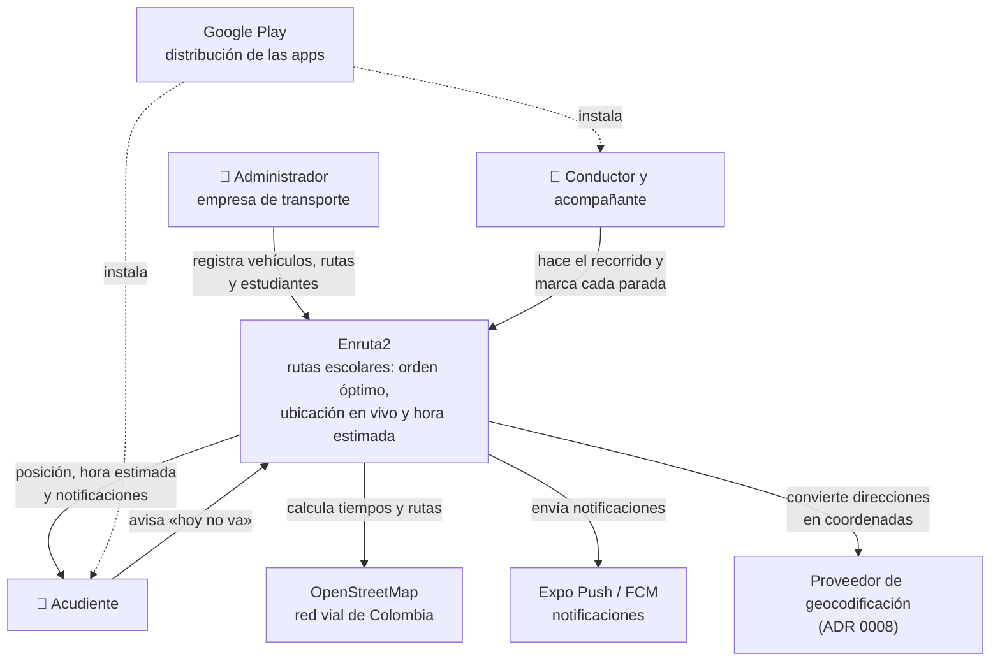
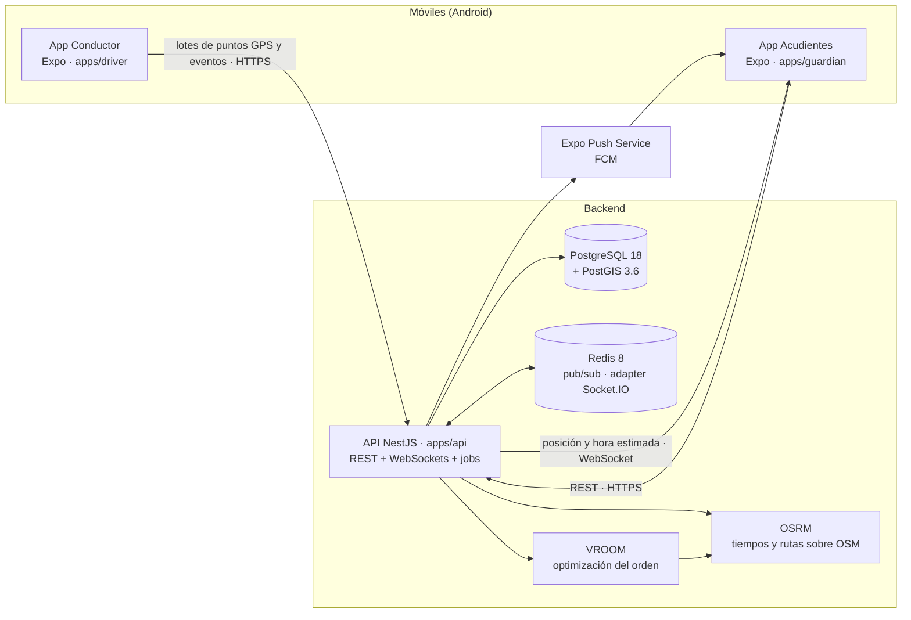

# Diagramas C4

Vistas de arquitectura según el [modelo C4](https://c4model.com). Están en Mermaid para que GitHub las dibuje y se versionen junto al código.

## Nivel 1 — Contexto

Quién usa Enruta2 y con qué sistemas externos habla.

## Nivel 2 — Contenedores

**Estado actual (Etapa 1):** existen las dos apps, la API con health checks, PostgreSQL/PostGIS y Redis. OSRM y VROOM ya corren en Docker con el Valle de Aburrá ([`infra/routing`](../../infra/routing/README.md)), pero la API los empieza a usar en la Fase 2; WebSockets y Expo Push llegan en las fases 3 y 4.
